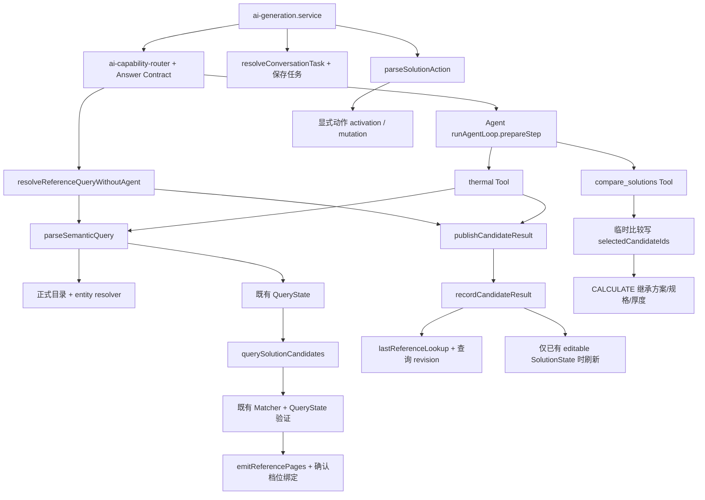

# Backend P0 对话路由与上下文：阶段 1 审计

日期：2026-10-12。范围：仅 backend 的静态审计、失败合同测试与修复计划。本轮没有修改业务源码、数据库 schema、migration、B/C 端或报告。阶段 2/3 的内容仅为后续实施计划，不代表已经修复。

指定的 `蓝格智配_Backend_134046_静态审计报告.md` 未在 backend 文件清单中找到，按 Prompt 指定源码调用链审阅。开始时工作区已有大量未提交变更，包括本次调用链中的 generation、reference-query、solution-state 和两个工具；本文审计当前工作区版本，保留这些现有变更，不将其计为本轮产出。

结论：不存在统一的领域追问边界。查页与查表共用入口；Agent 首步会强制 thermal；非 Agent 不复用只读来源；动作模型在能力路由之前被调用；临时比较写入计算会读取的 Selected。正式 Matcher 已支持 `systemIds`，但上游名称派生族可能漏掉硬条件。27 条新增测试中，11 条验证现有保护、16 条复现待修复合同。真实 PostgreSQL 连接被拒绝，真实模型与 HTTP/SSE 验收 BLOCKED。

## 1. 调用关系与状态写入



相关位置均为本轮审阅时的一基行号：

- `src/modules/ai/ai-generation.service.ts:357` 在能力路由（375）与 Agent 开关（403）之前调用动作解析；431 仅在没有 `solutionIntent` 时运行非 Agent 查询；580 优先消费动作澄清。
- `src/modules/ai/ai-agent.service.ts:548` 根据历史候选是否存在决定首步强制 thermal。只要回答合同为 REFERENCE_LOOKUP/THERMAL，原页/参数请求就可能进入此分支。
- `src/modules/ai/reference-query.service.ts:23` 仅有比较的特殊分支；53–76 的其他请求统一经过语义分类、候选查询、发布新 Candidate Result。
- `src/modules/ai/tools/thermal-calculate.tool.ts:201` 有历史复用，但 266 无论复用还是新查询均发布 Candidate Result；303–308 使用 `selectedCandidateIds`，没有该字段时还会使用整个历史候选列表的单项候选补齐计算入参。
- `src/modules/ai/candidate-result.service.ts:24` 委托 `recordCandidateResult` 后发送 `reference_candidates`。`solution-state.service.ts:126` 每次记录推进查询 revision；仅已有同项目 editable state 时刷新方案。这部分生命周期本身有正确保护，应保持。

## 2. 文件级根因清单

| 编号 | 文件/位置 | 根因与影响 | 证据级别 |
| --- | --- | --- | --- |
| R1 | `ai-generation.service.ts:357,431,580`；`solution-action-semantic.service.ts:28,50` | 动作模型的门控仅排除无候选、简单确认/应答、符号查询；普通有候选聊天仍请求模型。故障返回带 SELECT 的澄清对象，阻止正常查询/问答。Agent 开关无法消除此上游问题。 | 实际服务测试复现 6 条故障；调用顺序静态核验 |
| R2 | `ai-capability-router.ts:110`；`shared/ai-answer-contract.ts:53,59`；`thermal-query-lifecycle.ts:12` | 能力布尔值、回答合同、查询生命周期分别解释意图，均无 VIEW/DETAIL。指代词把页面、参数、比较、条件增改一起送到查表入口。比较能力的词表与查询生命周期词表也不一致。 | 静态；真实 prepareStep 路径测试 |
| R3 | `ai-agent.service.ts:548` | 对历史候选的存在做强制工具选择，原页与完整表格首步均强制 thermal。 | 2 条 prepareStep 合同失败；SDK/传输使用替身 |
| R4 | `reference-query.service.ts:53,57,76` | 非 Agent 原页请求未分流到可读原页服务，先重查，再发布/替换 lookup、推进 revision。页面请求可改变可见顺序和已有 editable state 的方案池。 | 2 条服务合同失败；数据库事务为替身 |
| R5 | `tools/thermal-calculate.tool.ts:202,243,266` | Agent 工具即使成功复用历史候选，也复用整个候选列表，缺少“第一个”的来源定位，并在末尾刷新 lookup/revision。复用不是只读 VIEW。 | 2 条工具测试：未重查仍发生 lookup/revision 变化 |
| R6 | `thermal-query-dictionary.service.ts:27`；`thermal-query-state.ts:59`；`thermal-entity-resolver.ts:108`；`db/schema.ts:2331` | `family` 从正式名称做字符串删除派生；`systemType` 是未冻结分类的自由字符串；没有正式 `familyCode`。复杂名称派生为“真空绝热板薄抹灰”等长片段，用户“薄抹灰”不命中；未命中并不总澄清。语义 parser outage 的 legacy fallback 可留下只有 K 的查询。 | 标准名称测试通过；复杂名称硬条件消失合同失败。未证实生产同一会话实际返回金属面 |
| R7 | `reference-query.service.ts:48`；`tools/compare-solutions.tool.ts:73`；`reference-candidate-selection.ts:10` | 临时普通比较范围写入 lookup 的 `selectedCandidateIds` 和 query.intent；后续无明确引用时 selection helper 可复用该字段。比较与用户正式选择没有授权来源区别。 | 两种入口均复现事实范围正确但持久状态被改 |
| R8 | `tools/thermal-calculate.tool.ts:303` | 计算把 lookup.Selected 当授权来源；没有 Selected 时，单项历史候选也被自动当作计算对象。两个比较对象不会立即继承单项，但进入单项上下文后该来源缺少授权证明。 | 单个未选候选 + 仅模型提供 CALCULATE/mode 已实际调用计算服务替身 |
| R9 | `reference-candidate-selection.ts:5`；`ai-generation.service.ts:359` | 当前序号 helper 不接收 revision；generation 的 revision 拒绝仅对 `solutionIntent` 生效。普通查页/详情/比较没有统一的旧卡片 revision 拒绝路径。 | 静态；新 Resolver 的旧 revision 测试待实施 |
| R10 | `tools/compare-solutions.tool.ts:47,56,65`；`reference-query.service.ts:28` | 有 editable state 时普通比较优先读全部真实 Selected，可能忽略本轮明确“第一和第三个”；没有 state 时工具可回落到模型提交 candidateIds。需统一按本轮明确授权的当前范围读取。 | 静态；完整生成入口与范围授权测试待实施 |

不应归因于 Matcher 或重写它：`thermal-candidate-matcher.ts:211` 已约束非空 `systemIds`；`thermal-query-state.ts:83` 会拒绝族集合外候选。正式 Query Service（`solution-candidate-query.service.ts:13`）再次核验硬条件、统一排序并绑定来源，`isFallback` 固定 false。问题在上游没有形成可靠的族 ID 集合，不能用放宽查询或重写公式解决。

知识回退路径：generation / `tools/search-knowledge.tool.ts` → `loadPublishedKnowledgeReferences` → `matchConfirmedPageOptions` → 既有 Matcher。`ai-reference-pages.service.ts:48` 传入 query 后，`knowledge-test-reference.ts:101` 继续透传给 Matcher；完整 `systemIds` 能约束回退。缺失族条件的 query 则无法由下游恢复，因此两个正式查表入口和知识回退必须共用同一次已核验的族条件，不得重新从问题猜一个宽查询。

## 3. 必须保留的现有安全边界

- `solution-state.service.ts:126` 普通查询不会创建 state，Confirmed 后只保存新 Candidate Result；已有 editable state 刷新仍保留真实选择与硬冲突。现有 `solution-state.service.test.ts` 已覆盖这些行为。
- `activateSolutionFromLastLookup:171` 在事务中验证查询 revision、24h 有效期、项目/会话权限、候选完整性与当前来源，然后 seed + 既有 mutation。不要把 VIEW 接入此入口。
- `groundSolutionAction` 不接受模型正式 ID；同厚度/同构造不唯一需澄清；只有明确完整确认命令可 CONFIRM，普通“行/可以”不确认。
- `emitReferencePages:370` 重验当前发布、生效、项目范围、来源文档，并绑定确认档位；`readConsumableReferencePages:18` 和 `restoreReferencePageMatches:95` 可复用做只读原页核验。旧签名 URL 和旧 optionId 不是当前事实。
- 源服务假设上游已经完成用户/项目授权。新增 Resolver 必须接收已鉴权的会话上下文，并重验本人、clientApp、会话状态与项目可见性，不能仅传 projectId 当授权证明。
- Snapshot/DocumentModel/Report 与 Candidate Result、SolutionState 分离；本轮不改变这些层。

## 4. 最小改动计划（阶段 2/3，尚未执行）

### 4.1 单次领域决策

新增小模块承载 `REFERENCE_QUERY / REFERENCE_REFINE / REFERENCE_VIEW / REFERENCE_DETAIL / COMPARE_SELECTED / SOLUTION_ACTION / GENERAL` 的 domain follow-up 决策。它表达读/查/改状态的边界，不改变既有 QueryState schema 或 Matcher。

在 generation 的动作 parser、任务状态保存与 Agent 首步工具选择之前生成同一决策，传递给两种模型开关路径。UI 明确操作与显式确认优先；语言分类只给意图与原话证据，Backend 核验是否有真实增改条件、候选引用与动作授权。无新的查询条件时“看原页/完整表格”是 VIEW；参数问题是 DETAIL；普通 K 概念/问候是 GENERAL；局部条件变更才是 REFINE；完整独立目标问题才是 QUERY。复合请求如“第一个和第三个比较并留下第一个”需拆清授权或澄清，不隐式扩范围。

保留现有明确正式计算/合规入口，另有是否授权执行计算的决定；“这个K怎么算”缺乏执行授权时先说明/澄清，不凭模型 CALCULATE 指令继承历史并执行。不要以“有候选”替代任何一种意图判断，也不要仅追加“原页”Regex 后继续 thermal。

### 4.2 只读 Candidate Reference Resolver

新 Resolver 的输入包含当前 lookup、可选调用方 candidateQueryRevision、用户原话引用与已授权会话上下文；输出为唯一正式候选、明确多项范围或澄清。必须：

1. POSITION 只映射实际发给用户的 `lastReferenceLookup.candidates` 顺序，且索引、revision、完整性有效；显式旧 revision 一律拒绝。没有卡片 revision 的纯文本指代仅绑定最近可见 lookup，不能猜旧列表。
2. “刚才18mm”、构造编码、明确 K、当前方案引用均在当前可见集合或明确真实 Selected 范围中核验；相同编码跨体系、同编码多厚度、同 K 多项均需澄清。显示数值涉及舍入时必须保留多项歧义，不能宽容差挑一条。
3. 核验 lookup 的项目一致性/失效标记和会话权限，再按候选 sourcePageId/optionId 读取当前确认页面；核验文档、版本、构造、厚度与四项参数同源。旧 optionId 变化时拒绝，不按旧数值重新绑定成新身份。
4. 复用可读原页服务构建完整 renderModel、重签图片 URL，通过兼容的 `reference_pages`/`sources` SSE 通道发送。图片失败保留表格；无正式页则说明不可定位，不能发起新查询。
5. VIEW/DETAIL 的执行不调用 `querySolutionCandidates`、不发送 `reference_candidates`、不写 QueryState/lookup/SolutionState、不激活方案。消息与来源元数据的正常保存仍允许，禁止持久化签名 URL。

generation 直接处理 VIEW/DETAIL，避免进入 runAgentLoop；Agent 工具若被误调用也必须检查 domain decision 并拒绝写入。该边界要在入口及工具两处防御，不能只依赖模型听从提示词。

### 4.3 查询/比较/动作隔离

- QUERY/REFINE 继续调用既有 semantic-query + 正式 Query Service，再发布 Candidate Result；只有真实新查推进查询 revision。Confirmed 后查询仍不创建 state。
- 普通显式“第一和第三个比较”经 Resolver 得到只读的本轮比较范围；“比较已选”只用真实 SolutionState Selected；未明确范围不扩大为全池。临时比较范围仅存本轮局部变量/回答事实，不写 `lastReferenceLookup.selectedCandidateIds`，不改变 query.intent。
- 只有真实选择/加入/移除/Final/显式确认等 SOLUTION_ACTION 才调用动作 parser 和 Grounding。动作模型 outage 时真实动作安全澄清，GENERAL/VIEW/DETAIL 不依赖该模型。明确确认维持现有 Fast Path，不能把其他意图分类升级成 CONFIRM。
- CALCULATE 继承依据为真实 SolutionState 选择或本轮明确授权、经 Resolver 验证的正式候选；旧 lookup.Selected 不能单独证明授权。不要仅删除比较写入后继续信任已有历史脏 Selected。真实修改仍使用既有 mutation 与确认安全边界。

### 4.4 正式 family 与迁移策略

`insulation_systems` 真实字段为 id/code/version/name/systemType/description/evidence/review/timestamps；没有 family。`systemType` 注释明确值域未确认，不应复用它为族权威字段。同 code 多版本的 ID 不同。

最小建议为增加 nullable `familyCode`（首批正式值 `THIN_PLASTER`）和集中维护的族 code/显示名合同；本轮查询无需增加 QueryState 字段，直接把该族下所有当前已发布有效系统解析成现有 `systemIds`（单项可用 systemId）。薄抹灰中文识别只定位正式 family code，正式系统归族关系来自存储数据，不从名称删除/拼接生成。alias/fuzzy/LLM 可以提出名称建议，但 Backend 仍验证映射与 ID，不让建议签发正式身份。

阶段 3 必须同时处理 backend 既有系统 create/update schema、DTO、service 与 new-version 复制，支持未来管理映射；复用 `/platform/construction/insulation-systems` 权限及审计，不开发 B 端页面。family 未映射为明确 NULL 状态，显式族名且无映射/映射不完整时阻止宽查询并澄清。正式全名可以在唯一性核验后解析为 systemId。

执行顺序：生成 additive migration → 静态检查 SQL/journal/snapshot → 隔离 PostgreSQL 执行验证 → schema 先部署 → 根据人工核验的明确 code/version 或 ID 清单审计回填 → 查看未映射/冲突清单 → 启用严格族解析。回填任务先 dry-run，输出拟改 ID、旧/新值与未映射原因，业务写入和审计同事务；禁止名称 LIKE/replace 批量猜测。回滚代码保留 nullable 新列，不做破坏性撤列。真实数据/分类目前无法读取，不能在阶段 1 捏造生产回填名单。本轮无 migration 产物或数据库更新。

## 5. 两轮会话验证矩阵

独立会话的第 1 轮统一为“薄抹灰K0.3左右有哪些”。fixture 的最近可见候选顺序为：C1=A1-1/18mm/K0.303，C2=A1-2/20mm/K0.295，C3=A1-3/25mm/K0.310，均属正式薄抹灰族；另放金属面夹芯板干扰项。真实 SSE 场景应从首轮实际展示事件取顺序，而不是写死假定目录顺序；这里为单测的受控数据。

首轮预期：`REFERENCE_QUERY`；QueryState 为 THIN_PLASTER 正式 systemIds + K APPROX 0.3，默认容差 0.02，不能包含旧热阻/厚度；调用查询一次，发 reference_candidates 与同源 reference_pages；查询 revision 从 n 到 n+1；无 active 时不创建 SolutionState，Confirmed 时不创建新 state，有 editable 时按既有刷新规则执行。映射缺失时澄清，候选为空，不扩大到金属面。以下第二轮均从同一首轮结果独立开始，revision 记为 r。

| 第二轮 | 领域意图 | QueryState 预期 | 后端/工具 | Candidate revision | SolutionState 与其他副作用 |
| --- | --- | --- | --- | --- | --- |
| 第一个原页 | REFERENCE_VIEW | 完全不变 | Resolver定位C1，仅可读原页服务；Agent前完成 | r，不重查/不重排 | 无新状态/选择；仅reference_pages、sources与正常消息落库 |
| 第一个完整表格 | REFERENCE_VIEW | 完全不变 | 同C1；整页renderModel完整保留其他构造/档位 | r | 同上，不能只裁C1，也不能发新候选 |
| 那20mm以内 | REFERENCE_REFINE | 保留族与K，thicknessMax=20；独立清理冲突精确厚度 | Agent thermal LOOKUP或非Agent同一Query Service | r+1 | 无active不建；有editable按规则保留选中/标冲突；Confirmed不建新state |
| 第一个留下 | SOLUTION_ACTION | 查询条件不变 | action parser→Resolver/Grounding→既有SELECT/懒激活事务 | 查询r不变；方案自身version/revision走既有规则 | 首次允许激活；真实选择C1；不设Final/不Confirm/不Snapshot |
| 第一个和第三个比较 | COMPARE_SELECTED（本轮明确范围） | 完全不变 | Resolver只取C1+C3，compare只读；不加C2 | r | 不创建/改变Selected、Final、query.intent或Snapshot；计算不继承临时范围 |
| 你好 | GENERAL | 完全不变 | 普通问答；不调用动作/热工工具 | r | 不激活、不写领域状态 |
| 这个K怎么算 | GENERAL解释或REFERENCE_DETAIL；对象不唯一则澄清 | 完全不变 | 解释已核验来源或澄清对象；不凭模型CALCULATE执行 | r | 不生成计算记录；明确要求执行并指定对象后才走既有计算入口 |

每一行必须组合验证：Agent enabled/disabled × parser available/outage。真实动作 outage 可澄清；VIEW/DETAIL/GENERAL 不能受动作 parser outage 影响。QUERY/REFINE 的语义 parser outage 只有可验证的既有解析可继续，不能丢族条件、默默减掉条件或猜正式 ID。

当前执行覆盖与缺口：

| 范围 | 实际执行 | 当前结论 |
| --- | --- | --- |
| 动作 parser outage + 有候选/无候选 | 实际 `parseSolutionAction`，runtime故障替身 | 有候选的6种非动作失败；无候选保护3条通过；真实选择故障只澄清通过 |
| Agent enabled 后首步 | 实际 `runAgentLoop.prepareStep`，SDK/工具/DB替身 | 两种VIEW强制thermal失败；Refine/比较工具选择与GENERAL合同3条通过 |
| Agent disabled 服务路径 | 实际 `resolveReferenceQueryWithoutAgent`，语义模型故障替身 | 两种VIEW重查失败；普通比较写Selected失败；Refine正确继承且重查通过 |
| Agent thermal/compare工具执行 | 实际工具execute与历史复用，事务/模型/计算替身 | VIEW即使不重查也改lookup/revision，两种；COMPARE改Selected；单候选无授权计算，共4条失败 |
| 首轮族/生命周期 | 实际目录解析、归一与硬条件验证 | 普通名称约束通过、复杂名丢族失败、同编码体系消歧通过、局部与完整新查询通过 |
| 完整generation可用parser组合、两轮真实首轮查询 | 本轮未做完整生成入口集成 | 不能把分段单测算作整条会话四组合通过；后续补足 |
| 真正HTTP/SSE、鉴权DB事务、真实AI | PostgreSQL只读SELECT 1被拒绝 | BLOCKED，执行业务轮数0；模型服务可达性未独立验证 |

## 6. 扩展回归与实施验收缺口

| 场景 | 必须断言 | 现有证据/下一步 |
| --- | --- | --- |
| 复杂正式体系名、族无映射、部分映射、废止版本 | 不丢族；同族有效ID；无映射澄清 | 新增复杂名失败；正式family存储与回填测试待阶段3 |
| 同编码多体系、多厚度、18mm/K0.303不唯一 | Resolver仅当前可见集；歧义澄清不选事实 | 同编码已有解析单测通过；VIEW/DETAIL Resolver尚未存在 |
| 完整新问题与局部Refine | 新问题清旧条件，Refine局部更新并重查 | 新增归一/服务/首步测试；真实SSE待补 |
| 旧revision/旧列表文本引用 | 拒绝旧卡片，不映射新第一项；不写状态 | 既有activation/Grounding测试在全量测试通过；VIEW/COMPARE专项待补 |
| 撤回、换版、过期、旧optionId、跨项目/跨用户/跨端 | 来源不再可读、旧身份不复活、无旧签名URL信任 | 既有原页防御/历史恢复/方案权限测试通过；Resolver端到端待补 |
| parser outage、无Candidate、普通问候/解释 | 非动作不依赖动作模型；不能把缺候选变成query/activation | 新增有候选失败与无候选保护通过 |
| Confirmed后新查询 | 仅新Candidate Result，不新建state/不改旧Snapshot | 既有solution-state测试通过；新domain与真实生成组合待补 |
| 知识回退不扩宽体系 | 回退消费同一正式systemIds与完整条件 | 下游Matcher支持集合；新增family门控与回退集成测试待补 |
| 比较后正式计算 | 临时范围不写Selected；旧脏Selected不能授权；真实选择才可继承 | 两种比较写入及单候选无授权继承已复现；完整多轮链路待补 |
| 明确Final与Confirm | Final不等于Confirm；来源/快照安全边界维持 | 既有测试全量验证；本轮不改 |

## 7. 新增文件、实跑记录与重现

本轮新增4个文件：

- `src/modules/ai/domain-followup-p0.audit.test.ts`：14条，7条已知失败、7条正常断言。
- `src/modules/ai/reference-followup-p0.audit.test.ts`：8条，7条已知失败、1条正常断言。
- `src/modules/ai/agent-followup-p0.audit.test.ts`：5条，2条已知失败、3条正常断言。
- 本审计文档。

阶段1为保留失败用例又不把既有测试套件永久置红，待修复合同使用 `it.fails`，不是跳过或通过业务验收。修复后该用例会因“不再失败”而报警，必须转换为普通 `it`。提供 `P0_EXPECT_FIXED=1` 把所有合同变为普通断言，明确查看当前16条实际失败，不可以把默认expected-fail计为修复成功。

Windows PowerShell重现全部失败合同：

```powershell
$env:P0_EXPECT_FIXED = '1'
pnpm test --maxWorkers=4 src/modules/ai/domain-followup-p0.audit.test.ts src/modules/ai/reference-followup-p0.audit.test.ts src/modules/ai/agent-followup-p0.audit.test.ts
Remove-Item Env:P0_EXPECT_FIXED
```

2026-10-12 本机实跑：

| 命令/检查 | 实际结果 | 可证明的范围 |
| --- | --- | --- |
| 上述P0普通断言模式 | 27条：16失败、11通过；16个失败均为合同AssertionError | 源码服务/工具/首步的受控复现，不是UAT |
| `pnpm test --maxWorkers=4` | 173文件通过、1跳过；1826普通通过、16 expected fail、1跳过，共1843条；51.15s | 全量本地测试，已知P0问题仍保留 |
| `pnpm lint` | 通过 | 项目TypeScript检查，tsconfig原本排除test文件 |
| 新增3个测试额外类型检查 | 通过 | 临时tsconfig包含这3个测试及`src/shared/fastify.ts`声明；临时文件交付前删除 |
| `pnpm build` | 通过 | 本地构建；没有部署 |
| `pnpm db:check` | Everything's fine | migration元数据静态检查，不证明迁移执行成功 |
| 配置数据库只读`SELECT 1` | BLOCKED：Error/ECONNREFUSED | 未写数据库，不输出连接或密钥；无法启动隔离真实业务UAT |

真实 PostgreSQL 迁移执行、实际模型准入配置/远程调用、完整 HTTP/SSE 四组合、对象存储重签与真实撤回来源验证均未通过本轮环境验收。需要可访问的隔离依赖后补跑；不根据Mock Prompt、SSE写入替身或db:check宣布业务通过。阶段2/3实施时只执行本文范围和原Prompt边界，保留既有模型准入、权限、正式查询、确认与快照流程。
