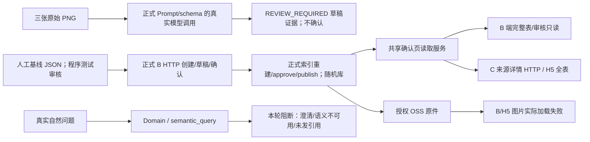

# 复杂热工图集阶段 5：真实三端联合 UAT 与回归

日期：2026-10-16。用户授权：在前阶段基础上继续阶段 5。

**结论：FAIL，尚不满足发布验收。** 本轮真实模型、随机隔离数据库、正式审核/发布 HTTP、B/C 问答 SSE、真实前端组件与 C 端 Store 均已执行。12 行事实在共享读取服务和 H5 来源详情表格中一致，但自然问答没有形成正确的结构化引用闭环，且出现芯层 R 被称为产品 R、浏览器原图加载失败。没有发布到业务环境，没有批量重新识别旧页面，没有修改业务库或旧 PDF。

## 1. 本阶段结论与真实执行范围

| 环节 | 状态 | 证据与适用范围 |
| --- | --- | --- |
| 三张原 PNG 身份及真实模型输出 | PARTIAL / FAIL | 原件 SHA 核对通过；单次真实推理得到 6 组、38 档，逐视觉组 R/K 全部一致；89 页漏印刷页码，75 页漏正式印刷编码，完整识别门槛未过。所有结果仍 REVIEW_REQUIRED |
| 正式页面创建、草稿、确认、索引、审核和发布 HTTP | PASS（隔离程序审核） | 新随机版本通过实际业务路由。事实装载自人工基线，确认人是程序测试账号，**不冒充真实人工逐页复核或 Vision 自动确认** |
| B/C 共用读取服务、真实只读数据库 | PASS | 六次结构化条件查询，12 行构造/option/revision 原子绑定；两端 RenderModel 相同，完整 38 档，90 页同值两组独立 |
| 自然语言 B 端 test-qa | FAIL | 三个正式 HTTP/SSE 问题均无 REFERENCE_PAGE；可见 KnowledgeTestPanel 再次复现 T01 失败 |
| 自然语言 C_APP T01—T11 | FAIL / PARTIAL | 11 轮真实消息接口，原始脱敏 SSE 和回答逐项留存。T01/T02/T03/T05/T08 未取得所需来源；T09 错称芯层为产品层 |
| B 端真实组件 | PARTIAL | 实际 KnowledgeRecognitionReview、KnowledgePageViewer、KnowledgeTestPanel 连接本轮隔离后端；三个完整表、发布只读状态和失败问答留截图。正式后台登录/菜单、可编辑人工操作 NOT_RUN |
| UniApp H5 真实 Store/组件 | PARTIAL | 实际 useAssistantStore、AiMessageList、aiApi、ReferencePageViewer、ThermalPageTable 连接真实隔离 API；程序注入临时 C_APP 登录。三个来源详情完整表共 12/12 DOM 断言通过，**来源详情直读不等于自然问答引用成功** |
| H5 窄屏滚动 | PARTIAL | 实际 376×811 CSS px；表头/表体 scrollLeft 同为 632.8358，90 页两组均在 DOM 中；精确 320/375/430 px NOT_RUN，不能用请求的 viewport 数字代替实际尺寸 |
| 原图浏览器实际加载 | FAIL | B 显示图片不可用和重取授权入口；H5 实际 getImageInfo:fail，显示失败和重试。Node 同一对象 HTTP/HTTPS 均 200，**不据此判浏览器 PASS** |
| 历史/重复事件/签名过期 | PARTIAL / NOT_RUN | 实际 Store 发送后重读本人历史，普通回答恢复；本轮无正确自然引用可验证历史高亮。真实过期签名恢复、故障后来源恢复、重复来源事件、完整页面路由恢复 NOT_RUN；前阶段 Fixture 不升级为本轮真实通过 |
| 权限与只读副作用门禁 | PASS（所列负例） / PARTIAL | 草稿来源、别人会话、C 访问 B、已发布页编辑、撤销版本来源均拒绝；11 轮没有 solution state/snapshot/report。跨项目全矩阵与正式 Confirm→PDF 真实正向 NOT_RUN。未登录响应 HTTP 状态有单独缺陷 |
| 旧 A3、890 档、报告 | PARTIAL | 源库显式只读核得 79 页、890 个确认 options（830 个四字段完整），实际 thermal_reference_rows 为 2。A3 四基层 45mm 数字通过；旧查询验证在路由分类处失败。旧 PDF 端到端运行 NOT_RUN |
| 隔离与清理 | PARTIAL→修正后 PASS | 首两次页面创建派生副本漏入通用 OSS 路径；已按本轮文档/版本/精确 key/SHA 清理 6 个副本。新增测试适配器统一对象前缀，另跑正式创建/审核/发布 smoke 通过。4 个随机 DB、对应 Redis 与所有核查对象清理后复查 PASS；源库前后计数一致 |

原始证据入口：[完整隔离 UAT](evidence/complex-atlas-phase5/real-uat/report.json)、[真实识别](evidence/complex-atlas-phase5/vision-frozen/report.json)、[人工复审后的数字说明](evidence/complex-atlas-phase5/vision-independent-review.json)、[12 行 UI 断言](evidence/complex-atlas-phase5/browser-twelve-rows.json)、[清理复查](evidence/complex-atlas-phase5/cleanup-audit.json)。

### 实际调用链与测试边界

实际入口/函数：

- `scripts/verify-complex-atlas-recognition.ts` 复用 `src/shared/page-recognition.ts`、`page-recognition-evidence.ts` 的 Prompt、schema 和证据验证；调用真实配置模型。本轮不是上传队列 Worker 联测。
- B `POST /platform/knowledge/versions/:id/pages` → `knowledge-page-gallery.service.ts/createManualPage`；PUT recognition-draft / POST confirm-recognition → `knowledge-page-recognition.service.ts`；正式 index/rebuild、approve、publish 沿用 `knowledge.routes.ts`。第一次漏做正式索引，approve 返回 409；补齐测试步骤后成功，这是测试准备错误，不算产品缺陷。
- B test-qa → `knowledge-workflow.service.ts` → `semantic-query.service.ts` → `loadKnowledgeTestReferences`；C messages → `ai-generation.service.ts` → `resolveDomainTurn` / `applyDomainPolicy` → `reference-query.service.ts` → `loadPublishedKnowledgeReferences`。本轮自然提案没有正确进入共享页事实分支。
- 共享读取：`confirmed-page-facts.ts/queryConfirmedPageFacts` → `knowledge-page-render.ts` → `KnowledgeReferenceCitationStream`，在真实隔离库中直接注入结构化条件验证，通过；这个结果不能替代自然 HTTP/SSE。
- B 使用实际 `KnowledgeRecognitionReview` / `KnowledgePageViewer` / `KnowledgeTestPanel`，H5 使用实际 `useAssistantStore.sendMessage/loadConversation` / `AiMessageList` / `aiApi.getSourceDetail` / `ReferencePageViewer` / `ThermalPageTable` / `useReferencePageImage`。测试外壳源码在 [browser-preview](evidence/complex-atlas-phase5/browser-preview/server.mjs)，只代理本次 127.0.0.1 隔离 API，不合成业务 SSE/来源/图片，也不代表正式登录与页面路由验收。

## 2. 改动文件、最小范围和未改边界

本轮没有修改任何 `src/` 产品代码，也没有新业务 DTO、迁移或语义关键词规则。对照阶段 3 的 22 个 Backend `src` 文件及阶段 4 的 25 个 App 实现文件，哈希全部相同：[核对结果](evidence/complex-atlas-phase5/historical-source-hash-check.json)。此核对仅覆盖历史清单，不冒充全工作区审计。

| 文件（Backend 仓库相对路径） | 修改原因 / 最小范围 |
| --- | --- |
| `scripts/audit-complex-atlas-environment.ts` | 强制只读源库预检、计数和 Redis PING；不输出连接/密钥 |
| `scripts/run-complex-atlas-uat.ts` | 复用现有 UAT 环境，真实审核/发布、B/C SSE、权限负例、只读副作用检查；新增 setup-only 模式及全对象前缀代理、清理核验；失败用例使后续重跑退出非零 |
| `scripts/repair-complex-atlas-uat-storage.ts` | 仅清理本轮两个随机文档的 6 个精确派生副本，逐一验 SHA；把仍存活测试页指向本轮隔离前缀原件，不修改确认事实 |
| `scripts/verify-complex-atlas-real-reads.ts` | 在强制只读的本轮随机库调用正式 B/C 共享读取与引用解析；不绕用自然成功结论 |
| `scripts/verify-cross-page-reference-readonly.ts` | 仅增加可选输出文件参数，避免覆盖以前的 A3 回归报告；查询逻辑未改 |
| `tests/uat/environment.ts` | 配置复制源连接强制 `default_transaction_read_only=on`；原有随机库、Redis/队列与清理逻辑复用 |
| `tsconfig.uat.json` | 新测试脚本纳入类型检查 |
| `docs/ai/evidence/complex-atlas-phase5/browser-preview/*` | 可复现真实组件测试外壳、只转发隔离后端；无需改产品页面或 store。临时登录不落交付证据 |
| 本文、`docs/ai/evidence/complex-atlas-phase5/*` | 原始 JSON、逐行对照、脱敏 SSE、截图、检查日志、失败清单和清理记录 |
| `AGENTS.md`、`README.md`、`.cursor/rules/30-ai-and-reports.mdc`、`.agents/skills/lg-backend/references/ai-and-reports.md` | 同步本轮 FAIL 状态和证据入口；没有放宽原约束 |

Admin/App 产品源码本轮未编辑；没有覆盖归档或已有工作区修改。未触及热工引擎、Matcher、Semantic Router 实现、报告生成、产品、采集 Source/Skill、公开文库和项目权限。

### 测试事实装载的明确偏差

- 真实模型输出与人工基线独立保存。人工基线用于审核/发布/检索/显示链测试，不能描述为“模型识别后人工已逐页审核”。
- 用户人工基线列为 I 级防水；本轮夹具和模型仍未核验该字形，`waterproofGrade=null`、界面显示“待核对”。不从 VICP I/II 型推断防水等级。正式资料发布仍需真实审核人员核实。
- 第 90 页人工夹具上半表的末三层 sourceLayerLabel/order 原为 4/5/6，测试临时副本对照原图改为 5/6/7。修改记录位于 `real-uat/report.json.fixture.corrections`，原夹具文件未变。
- 复用 UAT 工厂另含合成 A1 资料及其示意图；它们不是用户三图。T09 的自由回答同时引用合成资料，是来源混用风险的证据，不能用它证明真实图集的产品 R。

## 3. 接口、数据、版本与权限影响

新增兼容字段、迁移、旧 JSON 回填：**无**。产品接口和 RenderModel 仍为前阶段合同。来源标识继续为 pageId + constructionId + optionId + fieldKeys，并有 confirmedRevision/版本信息；本轮服务直接读取中 90 页两组 ID 独立。

只有本轮随机数据库装载测试账号、文档、确认与消息；源库用于配置和旧资料只读核查。随机库按既有迁移初始化，不是业务库迁移。首次页面创建派生图片漏出测试前缀属于本轮脚本错误，已单独记录，不能省略：

1. `knowledge-page-gallery.service.ts/resolvePageImage` 会产生 `knowledge/page-images/<本轮随机文档>/<本轮随机版本>/...` 副本，早期脚本只追踪了输入 key。
2. [修正记录](evidence/complex-atlas-phase5/storage-isolation-correction.json) 只处理这些精确 key，6 个副本逐一与原件 SHA 相同后清理；没有遍历或删除其他文档。
3. 测试 storage Proxy 现在把 put/get/stat/签名/remove 全部映射到本轮前缀。另建新随机环境运行完整正式创建/确认/索引/审核/发布 [setup smoke](evidence/complex-atlas-phase5/setup-smoke/report.json)，6 个新增对象均在前缀内且清理通过。
4. 最终 [cleanup-audit.json](evidence/complex-atlas-phase5/cleanup-audit.json) 只读检查四个本轮随机库均不存在、各前缀 Redis 为 0、核查对象及六个副本不存在，临时凭据文件删除；源库六项计数前后完全相同。

实际负例见 [permissions.json](evidence/complex-atlas-phase5/real-uat/permissions.json) 和 [发布只读/撤销](evidence/complex-atlas-phase5/real-uat/published-readonly-revocation.json)：DRAFT 来源拒绝，其他用户会话拒绝，C_APP 调 B 拒绝，已发布页编辑拒绝，disable 后来源拒绝。未登录 B 请求虽然 error.code=401，但 HTTP 实为 200，与项目约定的 HTTP 401 不一致，单列为协议缺陷；权限拒绝本身没有失效。

## 4. 测试证据与未通过清单

### 三张真实识别 JSON

| 页 | 原始模型 JSON / 校验后 JSON | 本轮判断 |
| --- | --- | --- |
| 89 | [raw](evidence/complex-atlas-phase5/vision-frozen/page-89.raw.json) / [structured](evidence/complex-atlas-phase5/vision-frozen/page-89.structured.json) | FAIL：2 组各 6 档 R/K 正确，印刷页码 null。屋面无印刷编码，保持 null 正确；缺失层/防水证据仍需审核 |
| 90 | [raw](evidence/complex-atlas-phase5/vision-frozen/page-90.raw.json) / [structured](evidence/complex-atlas-phase5/vision-frozen/page-90.structured.json) | PARTIAL：2 组各 6 档 R/K、页码正确，同值未合并；防水/完整层次和证据仍需审核，未达自动认可门槛 |
| 75 | [raw](evidence/complex-atlas-phase5/vision-frozen/page-75.raw.json) / [structured](evidence/complex-atlas-phase5/vision-frozen/page-75.structured.json) | FAIL：2 组各 7 档数值按视觉组正确，raw label 保留 C1-3/C1-4，却漏 constructionCode/编码证据。原严格检查 0/14 指“数值与正式身份同时匹配”失败，**不是 14 行数值全错** |

原件 SHA：89 `6d48ac8f8a746eb6c012f8c9ad6c2bf24a4161ab65b00ee9222f351e41a4ba9c`；90 `3cda1d4a7da48652b779c637bf19418c0fd4b894dccaaf0fdb951b7a8d916aa3`；75 `a712567ae0622aa41f14961f2cf6cd5ebe28e8ecf701391c0d6814dc3e6ebcea`。三图原件保存在 Admin 阶段 2 证据目录，2048×1471，未改图。未获得重复运行稳定性证明。

### 12 行逐项核对

R 单位 `(m²·K)/W`，K 单位 `W/(m²·K)`。来源三图的组表头均为原文“外墙主断面”，指标原文为“传热阻 R”；没有重命名成 R₀ 或屋面主断面。下表 PASS 仅指真实隔离库共享读取及 H5 来源详情 DOM，聊天自然召回仍 FAIL。

| 页 | 构造 | 板厚 mm | 源 R | 源 K | 共享服务 / 来源详情 UI |
| --- | --- | ---: | ---: | ---: | --- |
| 89 | I 型坡屋面正置 | 20 | 5.225 | 0.191 | PASS / PASS |
| 89 | I 型坡屋面倒置 | 20 | 5.198 | 0.192 | PASS / PASS |
| 89 | I 型坡屋面正置 | 25 | 6.025 | 0.166 | PASS / PASS |
| 89 | I 型坡屋面倒置 | 25 | 5.998 | 0.167 | PASS / PASS |
| 90 | II 型平屋面正置 | 20 | 5.369 | 0.186 | PASS / PASS |
| 90 | II 型平屋面倒置 | 20 | 5.369 | 0.186 | PASS / PASS |
| 90 | II 型平屋面正置 | 25 | 6.169 | 0.162 | PASS / PASS |
| 90 | II 型平屋面倒置 | 25 | 6.169 | 0.162 | PASS / PASS |
| 75 | C1-3 蒸压灰砂砖 240mm | 20 | 6.916 | 0.145 | PASS / PASS |
| 75 | C1-4 加气混凝土砌块 200mm | 20 | 7.540 | 0.133 | PASS / PASS |
| 75 | C1-3 蒸压灰砂砖 240mm | 25 | 8.516 | 0.117 | PASS / PASS |
| 75 | C1-4 加气混凝土砌块 200mm | 25 | 9.140 | 0.109 | PASS / PASS |

完整标识、query、B/C 模型及解析后引用见 `real-uat/read-{89,90,75}-{20,25}.json`，[共享服务汇总](evidence/complex-atlas-phase5/real-reads-summary.json)。38 档均保留；产品整体 R 仍 null，芯层值单独存放；H5 DOM 在 [h5-dom-89](evidence/complex-atlas-phase5/h5-dom-89.json)、[90](evidence/complex-atlas-phase5/h5-dom-90.json)、[75](evidence/complex-atlas-phase5/h5-dom-75.json)，12 行独立断言见 [browser-twelve-rows](evidence/complex-atlas-phase5/browser-twelve-rows.json)。

### 真实 T01—T12

原始 `Txx.json` 保留首次程序判定；下表是结合回答内容与真实 UI 结果的复审，不把初始 PARTIAL 当成功。

| ID | 复审结果 | 实际表现 / 未通过原因 |
| --- | --- | --- |
| T01 | FAIL | 明确 K 仍询问“产品 R / 整墙 R₀ / K”；0 引用、0 比较行。可见 B/C 复测也未返回结构化来源 |
| T02 | FAIL | 25mm 倒置追问变成要求体系/基层；未取得 89 页 5.998/0.167 |
| T03 | FAIL | 没有并列两组 90 页同值事实，0 引用 |
| T04 | FAIL | 上轮失败使“它们”无法定位；未按不同材料层解释，不能判完整连续对话通过 |
| T05 | FAIL | 未取得 C1-3/C1-4 两基层比较，0 引用；B SSE 把“问基层”误当成必须指定唯一基层 |
| T06 | FAIL | 新会话泛问体系/基层，没有给真实候选或只澄清必要型号/屋面形态 |
| T07 | PARTIAL | 区分型号和防水等级正确，无方案副作用；但又以未核验的 I 级字形描述源构造，不能作为来源事实通过 |
| T08 | FAIL | “没有可定位候选，请先查询/选择方案”，没有打开明确 90 页的完整表/原图/备注 |
| T09 | FAIL | 把 20mm 芯层热阻 4.800 称为“产品层热阻”，又从其他页引用换热阻；直接违背工程语义边界 |
| T10 | PASS（负例边界） | 要求补省份/具体对象，没有承诺达标、创建报告或 Snapshot。正式合规与报告正向联测 NOT_RUN |
| T11 | PARTIAL | 只读澄清来源/板厚，没有误认 Confirm；实际 5.369 核验未完成 |
| T12 | PARTIAL | 本人历史 HTTP 和 Store 普通回答恢复已跑；来源高亮恢复没有成功引用可测，真实签名失效恢复/移动端/正式页面刷新 NOT_RUN |

每轮回答及脱敏完整 SSE 均在 `real-uat/T01.json`—`T11.json` 和对应 `.sse.json`。本轮所有这些轮次 `solutionStates=0, reports=0, snapshots=0`，消息不持久化签名 URL。诊断见 [diagnostics](evidence/complex-atlas-phase5/real-uat/diagnostics.json)：T01 为 QUERY 但没有有效 pageQuery 路径；T03 为 SEMANTIC_UNAVAILABLE；T05 为 EVIDENCE_INVALID；T08 为 REFERENCE_VIEW 且没有当前候选，未转到按印刷页读取。这里只能证明实际路径，未捕获的结构化提案/模型错误细节不作猜测归因。

### 按根因分组的缺陷与下一轮最小定位

| 编号 / 优先级 | 类别 | 证据、准确定位与建议边界 |
| --- | --- | --- |
| P5-01 / P0 | 语义接入/检索 | T01/T03/T05/T08 和 B SSE；定位 `src/modules/ai/ai-domain-turn-decision.service.ts`、`ai-domain-policy.ts`、`semantic-query.service.ts`、`reference-query.service.ts`，B 入口 `src/modules/knowledge/knowledge-workflow.service.ts`。并列构造不应生成单 placement，参数读取不应要求数字目标。既有合同已可表示主要条件；先记录脱敏验证原因和模型提案、沿用一次复核及原预算，不新增关键词路由 |
| P5-02 / P0 | 自由回答工程语义 | T09；定位 `src/modules/ai/ai-generation.service.ts` 及其知识回答上下文/确定性回答分支。不能把层 R 从 fullText 解释成产品整体 R，也不能跨资料补源表没有的数值。共享事实层本轮通过，不应为此重写热工引擎或补算 productThermalResistance |
| P5-03 / P1 | 识别/身份/页码 | 89 pageLabel=null，75 constructionCode=null 但 raw label 有印刷编码；定位 `src/shared/page-recognition.ts` 和 `src/modules/knowledge/knowledge-page-recognition-output.ts`。先修通用 Prompt/证据审查并重复真实运行，不能按样本页码补值 |
| P5-04 / P1 | 图片授权/前端网络 | B 失败 UI、H5 getImageInfo:fail；`useReferencePageImage.ts`、`useReferencePageResource.ts`、`KnowledgePageImage.vue`、`KnowledgeOriginalPageViewer.vue` 为继续诊断点。Node 两协议均 200。尚未确定是浏览器网络、跨域或响应策略问题；**没有证据要求修改 OSS 签名算法或换一套图片组件** |
| P5-05 / P1 | 旧查询回归 | A3 四行真实原值正确，但只读脚本断言得到 GENERAL 而非 REFERENCE_QUERY。`src/modules/ai/ai-domain-turn-decision.ts` / 真实领域调用接线需继续核对；不能为使旧脚本通过而放回开放子串路由。用户旧能力必须另跑真实 Domain HTTP 证明 |
| P5-06 / P2 | 审核/测试环境 | 当前 B 只读审核控件可看，测试 B server 未注册无关 thermal/masterdata/construction 管理路由，关联列表部分 404；不冒充正式后台所有依赖可用。下轮真实可编辑审核仍需完整隔离应用及真实审核人员 |
| P5-07 / P2 | 鉴权传输合同 | 未登录 B 返回 HTTP 200 + error.code=401，实际已拒绝，但不符合项目 HTTP 401 约定。定位 `src/plugins/auth.ts` / `error-handler.ts` 后先复现，不能改权限准入来解决 |
| P5-08 / P1 | 测试隔离 | 本轮 OSS 派生副本遗漏已纠正并精确清理；测试 storage 边界统一命名空间和源连接强制只读，setup smoke/最终清理复查通过；不修改生产页面对象命名 |
| P5-09 / P2 | 未完成验证 | 精确宽度、真实 App/小程序、来源历史与完整页面路由、签名过期恢复、正式 Confirm→Snapshot→PDF、跨项目全矩阵 NOT_RUN。现有 Mock/单测不能顶替 |

无证据要求新增数据库字段或迁移。`knowledge-page-render.ts`、`confirmed-page-facts.ts`、两端来源列头/热工表组件本轮直接读取通过，暂不列为必改。不能根据本次语义失败重写整个知识库或全部样式。

### 截图及实际 UI 状态

| 范围 | 证据 |
| --- | --- |
| B 三页全表 | [89](evidence/complex-atlas-phase5/b89-real-table.jpg)、[90](evidence/complex-atlas-phase5/b90-real-table.jpg)、[75](evidence/complex-atlas-phase5/b75-real-table.jpg) |
| B 发布只读审核 / 自然问答失败 | [审核](evidence/complex-atlas-phase5/b89-real-review-readonly.jpg)、[问答](evidence/complex-atlas-phase5/b89-real-qa-fail.jpg) |
| H5 三页来源详情全表 | [89](evidence/complex-atlas-phase5/h5-real89-table.jpg)、[75](evidence/complex-atlas-phase5/h5-real75-table.jpg)、[90 窄屏](evidence/complex-atlas-phase5/h5-real90-narrow.jpg) |
| H5 90 页滚动后 R/K 与构造标签 | [窄屏滚动](evidence/complex-atlas-phase5/h5-real90-narrow-scroll.jpg)、[前后 scrollLeft](evidence/complex-atlas-phase5/h5-narrow-scroll-after.json) |
| C 真 Store 问答失败 / 原图失败 | [问答](evidence/complex-atlas-phase5/h5-real-qa-fail.jpg)、[原图失败状态](evidence/complex-atlas-phase5/h5-real90-original.jpg) |
| B 原图失败 | [原图错误反馈](evidence/complex-atlas-phase5/b90-real-original.jpg) |

部分旧标签页在 viewport 改变后截图通道失败，后来新建本轮临时标签页补录；没有把失败截图或默认宽屏截图冒作指定尺寸。所有本轮临时标签页已关闭，viewport 已复原。没有录屏或真机截图，均不声称完成。

### 命令与完整检查结果

以下以工作区当前代码运行，未自动修复 lint，未改依赖。

| 命令 / 范围 | 结果 | 日志 |
| --- | --- | --- |
| Backend `pnpm lint`，最终再次运行 | PASS | `backend-lint-final.log`，含语义 AST 10 文件 / 31 白名单检查 |
| Backend `pnpm build` | PASS | `backend-build-final.log` |
| Backend `pnpm db:check` | PASS（静态迁移检查） | `backend-db-check-final.log`；不是业务库迁移 |
| Backend `pnpm exec vitest run --maxWorkers=1 --reporter=default --reporter=json --outputFile=...` | FAIL | `backend-full.log/json`：200 文件通过、6 失败、1 跳过；2296 测试通过、52 失败、1 跳过 |
| `pnpm exec tsc -p tsconfig.uat.json --noEmit` | PASS | `script-typecheck-final.log` |
| Admin `pnpm exec vitest run --maxWorkers=1 --testTimeout=30000 ...` | PASS（1 跳过） | `admin-full.log/json`：109 文件通过、1 跳过；760 测试通过、1 跳过 |
| Admin `pnpm lint` | FAIL | `admin-lint.log`：4176 errors / 415 warnings，未作全库格式清理 |
| Admin `pnpm typecheck` / `pnpm build` | FAIL | `admin-typecheck.log` / `admin-build.log`：StandardSourcePanel.vue 的 row/index、review-center/queue 的 value 共 9 个错误 |
| App `node --test-concurrency=2 scripts/run-tests.mjs` | PASS | `app-test.log`：147/147；外层 flag 不等于其内部测试子进程已限制并发 |
| App `pnpm lint` | FAIL | `app-lint.log`：38 errors |
| App `pnpm type-check` | FAIL | `app-type-check.log`：第三方 @wot-ui/ui/wd-button 的 ButtonOpenType 类型不兼容。先误用了不存在的 typecheck 命令，保留该失败日志，随后已跑实际命令 |
| App `pnpm build:h5` | PASS | `app-build-h5.log` |
| 真实 Vision `node --import tsx scripts/verify-complex-atlas-recognition.ts --output .../vision-frozen` | FAIL（检查退出 1） | `vision-frozen.log` / `vision-frozen/report.json`；不是无模型 Fixture |
| 真实联合 `node --import tsx scripts/run-complex-atlas-uat.ts` | FAIL（验收） | `real-uat.log`；原脚本完成后退出 0 仅表示流程完成，**不代表用例通过**。已修正后续重跑为失败用例退出非零 |
| `node --import tsx scripts/verify-complex-atlas-real-reads.ts <临时桥接文件>` | PASS（直接结构化服务） | `real-reads.log` / `real-reads-summary.json`；不代表自然 HTTP 通过 |
| `node --import tsx scripts/verify-cross-page-reference-readonly.ts .../a3-source-readonly.json` | PARTIAL / FAIL（退出 1） | 显式 REPEATABLE READ READ ONLY，四行原值 PASS，路由判断 FAIL |
| 设置 `ATLAS_UAT_OUTPUT` 后运行 `node --import tsx scripts/run-complex-atlas-uat.ts --setup-only` | PASS | 全对象命名空间修正后的正式审核/发布重跑；`setup-smoke.log/report.json` |
| 清理后源库/随机资源只读复查 | PASS | `environment-after.json` / `cleanup-audit.json`；没有未清理本轮随机 DB/Redis/核查对象 |

日志均位于 [阶段 5 证据目录](evidence/complex-atlas-phase5/)。Backend 52 个失败与阶段 3 初次全量的 52 个**逐项相同**，相对另两次 53/54 失败记录没有新增失败；这说明不是本轮测试脚本引入的新产品回归，但仍是未通过项，不能写“Backend 全量通过”。详见 [逐项比较与错误摘要](evidence/complex-atlas-phase5/backend-failure-comparison.json)。

### 旧 A3 / Snapshot / PDF 边界

源库只读 A3 原始结果：III 型 45mm，A3-1 钢筋混凝土 `R=3.313 K=.302`、A3-2 混凝土空心砌块 `3.398/.294`、A3-3 蒸压灰砂砖 `3.416/.293`、A3-4 加气混凝土砌块 `4.040/.248`；印刷页 5/6。原始四行核对 PASS，随后旧路由期望失败，详见 [A3 原始记录](evidence/complex-atlas-phase5/a3-source-readonly.json)。

源库前后：knowledge_pages=79、thermal_reference_rows=2、solution_snapshots=0、reports=1、thermal_candidate_selections=0、ai_conversations=289，计数相同。**890 是确认 JSON 中 options 总数，不是当前正式 thermal_reference_rows 的数量。** 没有同步这些档位、重确认旧页、修改 Candidate/选中/Final、重建冻结快照或重新生成旧 PDF。真实旧报告下载/内容哈希/Worker 生成及 Confirm 正向流程 NOT_RUN，不能因本轮没有写数据就认定报告回归通过。

## 5. 下一阶段前置条件

发布前须解决 P5-01/02 的真实语义和工程事实问题、P5-03 识别身份/页码缺口，以及 P5-04 浏览器图片失败，并以同一组真实 T01—T12、正确结构化引用和可见 UI 重跑。保持最多一次语义复核、原超时预算、项目/版本/本人会话权限、人工审核和正式 Confirm 门槛。

还需补齐完整隔离后台可编辑审核、精确屏宽、可运行 App/小程序设备、来源历史/签名过期和正式 Confirm→Snapshot→PDF 的真实证据。没有提出迁移或外部部署请求；目前无需批准数据库迁移。当前已授权模型可调用，但不保证其提案和识别稳定性。

**现在不建议发布后端/B 端或批量重新识别旧确认页。** 后续只在明确批准的修复范围内推进，真实重新识别结果继续进入待审核草稿。

## 6. 停止状态

阶段 5 取证和失败清单已完成，联合验收未通过。本轮隔离资源与临时凭据已清理；已关闭测试服务和标签页。停在此阶段，等待用户回复继续；不部署、不迁移业务库、不重写旧资料、不生成正式报告。
