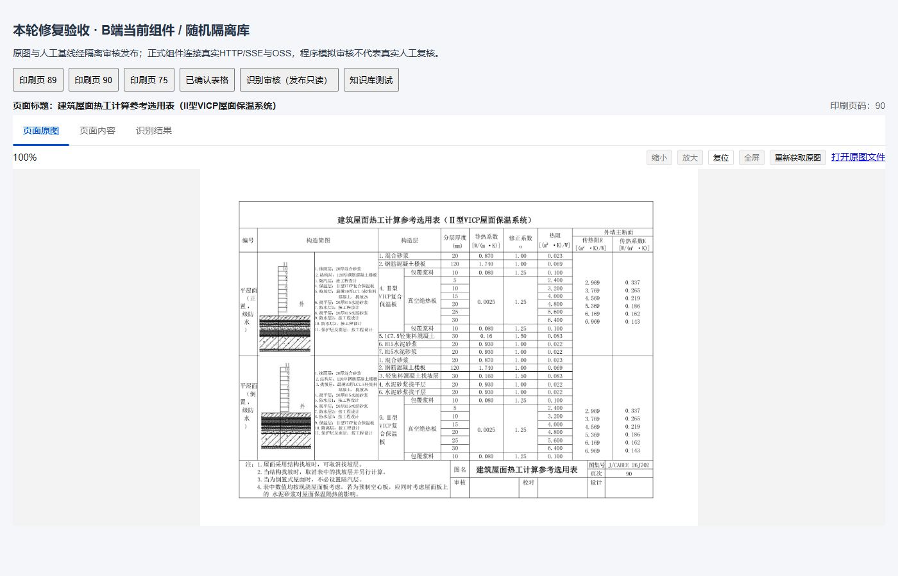
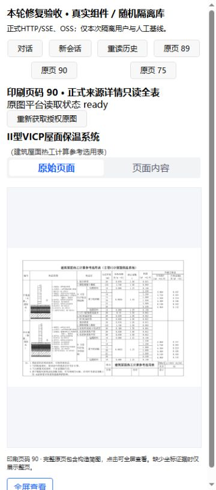
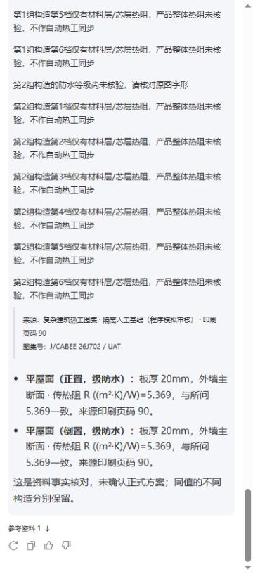

# 复杂图集审计后的修复与真实隔离复测（2026-10-16）

结论：**PARTIAL，尚未达到阶段5全量验收通过。** 用户在只读审计后批准继续修复、真实识别和隔离联测，并明确只有阿里云 OSS。本次修复已完成并留下证据；未部署，未迁移业务库，未回填旧确认数据，未修改冻结快照或旧 PDF。

前置审计及三端原调用链见 [完整审计](complex-atlas-three-clients-audit.md)。本报告是后续修复记录，不覆盖此前失败结果。证据根目录为 `docs/ai/evidence/complex-atlas-repair-2026-10-16/`。

## 1. 修复与边界

| 文件 | 修改原因和范围 |
|---|---|
| `src/modules/ai/confirmed-page-fact-verify.ts`（新增） | 从本人同端同会话/项目、24h 内最近实际显示的确认页引用核验数值；重验发布权限、资料版本、确认 revision、构造和 option ID。支持无印刷编号的 v2 页，不按待核数字反选档位、不创建 Candidate。 |
| `src/modules/ai/reference-fact-read.service.ts` | VERIFY 省略编号时先尝试上述确认页路径；旧编号资料核验继续走原路径。 |
| `src/modules/ai/thermal-answer-semantics.ts` | 可选来源语义限定裸 R 的归属；显式“产品热阻 R”不被二次识别成构造 R。其他调用保持原默认。 |
| `src/modules/ai/ai-domain-turn-decision.service.ts` | 仅补充既有语义模型提示：独立构造属性逐字段使用原话字形；型号/防水等级概念区别不误入构造数值核验。未新增关键词意图路由。 |
| `src/modules/knowledge/knowledge-page-recognition.service.ts` | B 端详情签名失败时返回空图片地址和可读提示，保留确认 JSON/RenderModel；重取详情可以重新签名。不吞数据库/权限错误。 |
| `src/modules/ai/confirmed-page-fact-verify.test.ts`、`src/modules/knowledge/knowledge-page-recognition-image.test.ts`（新增） | 19 项针对性回归：双构造同值、显式产品 R、错误数字、厚度、失效/部分失效引用、跨用户/端/项目、撤回、签名失败与重试。 |
| `domain-semantic-regression.test.ts`、`solution-advice-context.test.ts`、`solution-advice.service.test.ts` | 补齐新增历史读取依赖的内存桩，避免在模型调用前因空 DB 桩失败。 |
| `reference-candidate-resolver.service.test.ts` | 给来源回退测试补上受控版本范围；不放宽服务端版本要求。 |
| `solution-state.service.test.ts` | 状态保存桩真实更新内存状态，保留候选生命周期/确认快照断言。 |
| `solution.routes.test.ts`、`reports.routes.test.ts` | 未登录/失效/过期令牌按现有 HTTP 401 合同断言，权限不足仍保留业务 403 合同。未修改鉴权代码。 |
| `.env.example`、`src/config/env.ts`、`tests/uat/environment.ts` | 示例及缺省存储改为 OSS；真实 UAT 在创建库/队列前拒绝非 OSS。历史适配器兼容代码保留，本次没有启动或连接 MinIO。 |
| `scripts/run-complex-atlas-uat.ts` | B 端六问精确断言 12 行；断言构造身份独立、历史已落库；T11 接在 T03 后连续提问，T04/T07增加断言，PARTIAL不能汇总成PASS。 |
| `AGENTS.md`、`README.md`、`.cursor/rules/10-backend-architecture.mdc`、skill references | 记载用户 OSS 约束及本次修复/验收状态。 |

本机 `.env` 只更新 OSS 参数与匹配数据库的 AI 加密主密钥；该文件已被 Git 忽略，秘密值没有写入报告。未新增 DTO/数据库字段或迁移文件。`REFERENCE_PAGE` 继续携带完整 RenderModel、来源版本、confirmedRevision、constructionId、optionId、fieldKeys；新核验会更新同一档位的全部重复引用，并清除旧回答字符偏移。

## 2. 真实识别：数值通过，整页仍需审核

命令：`pnpm exec tsx scripts/verify-complex-atlas-recognition.ts --output docs/ai/evidence/complex-atlas-repair-2026-10-16/vision --image-dir <原PNG副本目录>`。

原图 SHA-256 与用户附件、此前基线一致，未重画或修改图片。源配置连接强制只读。使用数据库配置的真实模型及项目正式 Prompt、Zod、草稿证据处理和 RenderModel 生成函数；本项没有运行 Worker/队列确认闭环。

| 页 | 真实识别构造/档位 | R/K及构造归属 | 完整页验收 |
|---|---:|---|---|
| 89 | 2 / 12 | PASS | PARTIAL |
| 90 | 2 / 12 | PASS | PARTIAL |
| 75 | 2 / 14 | PASS | PARTIAL |

完整原始模型正文、结构化 JSON、RenderModel 分别在 `vision/page-{89,90,75}.{raw,structured,render}.json`，逐档结果在 `vision/report.json`，日志 `vision.log`。所有结果仍是待审核草稿，未自动人工确认或发布。

剩余问题：屋面防水等级字形仍未确认，不能把用户人工基线中的 I 级默认为识别事实；本次模型有将未印出的 λ/层热阻 R 符号写进来源列证据的情况，需人工去除/核对。原图明确整构造列为“外墙主断面 / 传热阻 R”，保留原稿，不能改为 R₀ 或自行改称屋面主断面。38 档数字一致不等于层序、全部原文、来源列符号已经全部通过；本次真实识别仅一次，不能宣称重复稳定性通过。

## 3. HTTP/SSE 与 12 行闭环

命令：设置 `ATLAS_UAT_OUTPUT=<本次新的证据目录>` 后运行 `pnpm exec tsx scripts/run-complex-atlas-uat.ts`。三次运行分别在 `real-uat/`、`real-uat-final/`、`real-uat-acceptance/`，失败/中间结果均保留。每次使用新的随机 PostgreSQL 库、Redis/队列前缀和 OSS 对象前缀；只有临时库初始化迁移，源业务库只读复制模型配置。

用于查询的事实是 **MANUAL_SOURCE_BASELINE，通过正式 HTTP 草稿、确认、审核、发布接口，由程序模拟审核**，并非上一节真实 Vision 输出被自动确认。页90上半表层序号5/6/7只修正临时副本，原测试夹具及旧资料未重写。

收尾三次运行均记录 `cleanup=PASS`，见 `runs-summary.json`；本次随机库/队列/OSS对象已清理，临时凭据桥接文件已删除，预览服务已停止。历史其他任务的隔离库和用户资料没有清理。

| 页/构造 | mm | R | K | 真识别 | B SSE | C SSE | H5 DOM |
|---|---:|---:|---:|---|---|---|---|
| 89 正置 | 20 | 5.225 | .191 | PASS | PASS | PASS | PASS |
| 89 倒置 | 20 | 5.198 | .192 | PASS | PASS | PASS | PASS |
| 89 正置 | 25 | 6.025 | .166 | PASS | PASS | PASS | PASS |
| 89 倒置 | 25 | 5.998 | .167 | PASS | PASS | PASS | PASS |
| 90 正置 | 20 | 5.369 | .186 | PASS | PASS | PASS | PASS |
| 90 倒置 | 20 | 5.369 | .186 | PASS | PASS | PASS | PASS |
| 90 正置 | 25 | 6.169 | .162 | PASS | PASS | PASS | PASS |
| 90 倒置 | 25 | 6.169 | .162 | PASS | PASS | PASS | PASS |
| 75 C1-3 蒸压灰砂砖 | 20 | 6.916 | .145 | PASS | PASS | PASS | PASS |
| 75 C1-4 加气混凝土砌块 | 20 | 7.540 | .133 | PASS | PASS | PASS | PASS |
| 75 C1-3 蒸压灰砂砖 | 25 | 8.516 | .117 | PASS | PASS | PASS | PASS |
| 75 C1-4 加气混凝土砌块 | 25 | 9.140 | .109 | PASS | PASS | PASS | PASS |

最终正式 SSE 中 T01–T09、T11、E01–E03 共13项 PASS，T10 PARTIAL：不承诺达标、未激活方案/确认快照/生成报告，但回答仍没有完整解释正式报告需要已确认快照的前置条件。T12完整故障、签名过期、离开/刷新恢复矩阵仍 PARTIAL/NOT_RUN。逐轮回答、真实 SSE、版本和来源 ID 见 `real-uat-acceptance/{ID}.json`、`{ID}.sse.json` 及 `report.json`；六个 B 端真实 SSE 在 `b-{89,90,75}-{20,25}.json`。

第一次 T06 因模型未按字段拆分构造属性失败；后续两轮已通过，原失败未删。中间一轮 T07错误索要构造编号，补充概念语义提示后最后一轮及浏览器问答通过。仅这些重复样本不能保证所有自然表达均稳定。

## 4. 浏览器：真实组件集成，非整站/原生端全验收

`real-preview/server.mjs` 将当前 B 端正式组件及 UniApp H5 组件连接随机测试后端。请求真正经过 HTTP/SSE/权限及 OSS，未合成业务响应。使用单独的验收页面承载这些组件，因此不能据此宣称完整产品路由、登录、原生 App 或小程序均验收。

- B：真实识别审核组件的已发布只读状态、三页全表/原图、知识库测试比较问答；原图实际浏览器解码三张均2048×1471，见 `browser/b-images.json`。
- H5：真实 Assistant Store、AiMessageList、独立结构化引用及完整表；T03→T11连续同会话、通过正式接口重读历史；三页38档全表，12行DOM按同构造同grid行核对通过。见 `browser/h5-three-pages.json`、`browser/validation.json`、`real-browser-requests.log`。
- H5 原图三张均实际解码2048×1471；不是用服务器200替代。见 `browser/h5-images.json`。
- 窄屏横向滚动实际执行，表头/表体滚动位置同步（均627，内容宽961，可视宽334）。尺寸校准尝试见 `browser/widths-uncalibrated.json`：当前浏览器返回的实际CSS视口仍360，即使设置320/375/430或iframe/viewport元数据也没有得到相应实测尺寸；**本轮准确320/375/430覆盖 NOT_RUN**，不把指定值当测得值。
- 原生 App、微信小程序 NOT_RUN。真实 OSS 签名自然过期、浏览器断网恢复、刷新后完整产品路由自动恢复 NOT_RUN。B 端保存/修订/人工确认操作本轮只通过正式HTTP程序测试，没有真实人工在UI审核，标PARTIAL。

截图（均为本次浏览器实拍）：

其他截图包括 `b-{89,90,75}-final-table.jpg`、`b-review-published-readonly.jpg`、`b-75-qa.jpg`、`h5-{89,90,75}-final-table.jpg`、`h5-75-horizontal.jpg`。早期图片/屏宽校准未完成时的证据保留，不将其作为原图解码PASS依据。

## 5. 自动检查与旧能力边界

| 检查 | 结果 | 证据 |
|---|---|---|
| Backend `pnpm lint` | PASS，含语义AST治理与TypeScript | `lint-final.log` |
| Backend `pnpm test --maxWorkers=1` | PASS，210文件通过、2377项通过、1项跳过 | `backend-test-release.json/.log` |
| Backend `pnpm build` | PASS | `build-final.log` |
| Backend `pnpm db:check` | PASS，静态迁移一致性，非业务库迁移执行 | `db-check-final.log` |
| DOM12行验证 `node .../verify-browser.mjs` | PASS，12/12及3张原件解码 | `browser/validation.json` |
| B/App全量检查 | 沿用本轮此前审计，未重跑全部前端检查 | 原审计证据目录 |

此前 B 端760项测试通过、1项跳过，但全量lint和typecheck/build仍有既有错误；App148项测试通过、H5构建通过，lint/typecheck仍有既有错误。本次未修改前端产品代码，不能宣称三端全量质量门禁都通过。

源业务库只读复核 `source-after.json`：79页、890确认档、2条热工行、0快照、1报告、0候选确认、289会话，计数与审计前一致。该检查是计数，不冒充每行/每份PDF字节hash。正式A3查询因源版本DISABLED仍NOT_RUN；此前原始A3值核对正确，不为通过测试重新发布源资料。冻结Candidate/Snapshot/PDF不随本次修复回填或重算。

## 6. 未通过与下一步

阶段5仍为PARTIAL：真实Vision细节与防水等级需人工审核；T10报告前置解释需继续完善；精确屏宽、完整产品刷新/故障/签名过期矩阵、原生App/小程序、旧A3当前有效发布查询仍有未跑项，前端既有lint/typecheck/build失败未在本轮修复。

本轮只修复已证实的核验和图片退化缺陷、语义提示与测试环境。继续验收应使用OSS隔离前缀和人工审核流程，不迁移/重写业务数据，不自动确认或部署。
