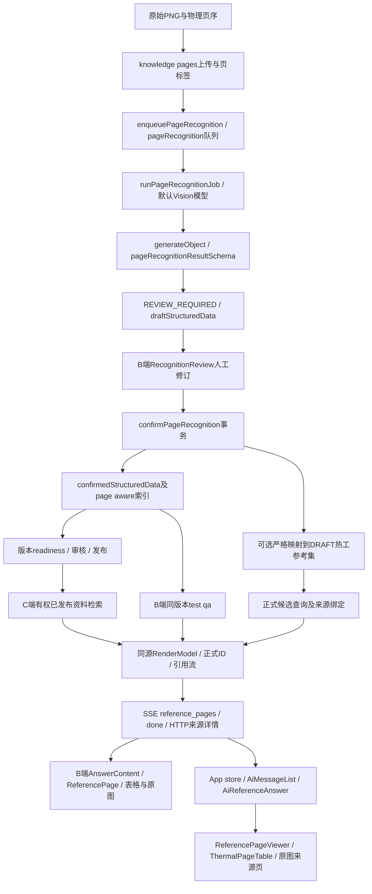

# 复杂建筑热工图集三端闭环：阶段 0 现状审计

审计日期：2026-10-15（Asia/Hong_Kong）。范围：当前 `D:/work/lg-vicp/{backend,admin-web,app}` 源码、三张用户原始 PNG、当前配置库的强制只读清点、真实 Vision 推理核心、现有测试，以及隔离 Fixture 下的真实 B / UniApp H5 组件。**结论为 PARTIAL，不能作为三端闭环验收通过。停在阶段 0。**

## 1. 执行边界与证据说明

- 本轮仓库只新增本文；没有实施阶段 1—5，没有修改业务代码、识别 Prompt、Schema、匹配规则、源图片、业务资料或权限，没有迁移、seed、部署、确认、发布或生成报告。
- 开始时三端已有未提交修改，尤其 Backend 的 Domain/Reference 路径、App 的消息组件；本审计读取这些当前文件，没有用归档覆盖。已阅读 Backend `AGENTS.md`、`.agents/skills/lg-backend/SKILL.md` 及其 AI 参考、Admin `AGENTS.md`；App 根目录没有 `AGENTS.md`。
- 当前 `.env` 指向的库只以 PostgreSQL `transaction_read_only=on` 读取。实查 **79 页、2 条 thermal_reference_rows、0 个 SolutionSnapshot、1 个 reports 记录，A3-1～A3-4 构造数为 0**。这不是已证明包含旧 890 档位的验收库。
- 当前库唯一匹配印刷页码 75 的页是 `166ddda5-213a-47a9-8b24-a3b338d50ed1`，版本 `4929cc99-3269-41ce-b878-567cbf5fdb4e`，PUBLISHED / AI_ENABLED / ACTIVE、CONFIRMED、MANUAL 页码；快照构造是 **G2-1/G2-2**，不是附件 C1-3/C1-4。只记录差异，不判定这条现有数据错误，也不覆盖它。印刷页码不能单独作为来源身份。
- 真实模型：按项目 `resolveDefaultVisionModel` 从只读配置解析，配置 modelId=`deepseek-chat`、准入 PASSED / supportsVision=true；本次响应体的 model=`deepseek-flash`。这里只记录配置名与服务端返回名不同，不推断网关内部模型。没有打印密钥、Token 或签名 URL。
- 真实调用使用项目原有 `buildPageRecognitionPrompt`、Zod schema、`repairPageRecognitionText`、PAGE_RECOGNITION 策略和 AI SDK `generateObject`。三张原 PNG 以 data URL 送入，documentTitle/pageLabel 留空、physicalPageNumber=1，避免用人工页码提示掩盖识别问题。**没有运行生产 Worker Job、Redis 队列、OSS 上传或确认事务**；所以“真实 Vision 推理已执行”不等于“完整正式 Pipeline 已执行”。每页仅一次，重复运行稳定性 NOT_RUN。
- 现有 `tests/uat/environment.ts` / `scripts/verify-knowledge-page-references.ts` 会创建临时库并 migrate、造用户和资料；与本阶段“不迁移”边界不符，未执行。没有把正式 B 端 test-qa 发到现有库，因为 `streamVersionTestQa` 会写会话、消息及审计。
- B 端浏览器实际页可打开但在登录页；现有 Edge 已登录标签连接先超时、后返回 Debugger unattached。没有绕过登录、验证码或拿后台签名冒充用户授权。
- 为取得可核验的组件证据，在仓库外建立临时只读 Fixture 页：B 端直接 import 当前 Vue 组件，H5 使用当前依赖中的 Uni 编译器及当前 `ThermalPageTable.vue`。没有复制/改写生产组件；原图通过本地 HTTP 原字节读取。Fixture 页明确写“模型输出、未经人工确认、无正式业务接口”。其回答是测试夹具文本，不是小格真实模型问答。

证据根目录：`C:/Users/admin/AppData/Local/Temp/vicp-complex-atlas-audit-20261015`。为遵守“只生成一个仓库文档”，脚本、原始模型响应、日志、截图均保存在此目录；本文附录另内嵌三页结构化 JSON 和全档位数值对照，避免核心数值证据只留在临时文件。临时目录不是长期归档，截图与原始响应需随审计保存；未把图片编码塞进业务数据。

状态定义：PASS=本次明确范围内实测通过；PARTIAL=部分实测或静态能力成立但关键链路未执行；FAIL=实测/明确代码证据不满足；NOT_RUN=没有执行，不等于失败或通过。

## 2. 真实调用链与各环节状态



下表文件均以各端根目录为基准；函数名以本次读取到的工作区为准。

| 环节 | 实际文件 / 函数 / 字段 | 本阶段状态及证据边界 |
|---|---|---|
| PNG、页序与印刷页码 | Backend `src/db/schema.ts` 的 `knowledgePages`：documentId/versionId、physicalPageNumber、pageLabel、pageLabelSource、pageLabelVerified、pageImageObjectKey、metadata；`src/shared/page-label.ts` 的 uploadedPageLabel / visiblePageLabel | PARTIAL；原图/哈希核实，源库只读清点；未上传/建页。FALLBACK 或 verified=false 不可冒充印刷页码 |
| 识别入队 / Worker | `src/modules/knowledge/knowledge-page-recognition.service.ts` 的 enqueuePageRecognition、runPageRecognitionJob；`src/queues/queues.ts` 的 pageRecognition；recognitionRunId 做 single-flight / 旧任务门禁 | PARTIAL；本轮未跑队列，现有回归有覆盖。重识别保留 confirmedStructuredData，不把候选直接写正式事实 |
| Vision / Zod | `src/shared/page-recognition.ts` 的 layer/system/option/result schema、PAGE_RECOGNITION_SYSTEM_PROMPT；识别服务 buildPageRecognitionPrompt；`knowledge-page-recognition-output.ts` 的 repairPageRecognitionText / normalizePageRecognitionAnnotations | PARTIAL；真实三图返回 2+2+2 组、38 options，12 指定行数值 PASS；页码、假编号、语义字段仍 FAIL，见后文 |
| 草稿 / 审核 UI | `KnowledgeRecognitionReview.vue`→recognition/RecognitionBasicSection、RecognitionThermalSection、RecognitionMappingSection；`src/api/modules/knowledge.ts`→GET recognition、PUT recognition-draft、POST confirm-recognition | PARTIAL；实测热工子组件只读控件；完整审核弹窗/保存/确认 NOT_RUN。当前没有屋面维度/原列头审核控件 |
| 人工确认 / 热工同步 | confirmPageRecognition：行锁重验版本、REVIEW_REQUIRED、fullText，冻结快照、重建 chunks、标记 contentRevision/indexDirty、同事务审计；syncThermalRowsFromConfirmedPage 仅显式 thermalSetId，要求 DRAFT、构造/产品映射及四字段 | PARTIAL；静态及既有模拟事务测试，真实确认 NOT_RUN。单页确认可以无编号，不选热工集可仅资料问答；批量安全检查/正式同步仍更严格 |
| 发布 / 正式读取门禁 | `knowledge.routes.ts` publish / index rebuild→`knowledge-workflow.service.ts` readiness；`ai-reference-pages.service.ts` readConsumableReferencePages→`reference-page-access.ts` isReferencePageConsumable | PARTIAL；静态/模拟测试。正式读取要求当前版本、PUBLISHED、ACTIVE、生效、AI_ENABLED、项目范围；没有放行草稿或公开阅读数据到正式 AI |
| B端知识库测试 | POST `/api/v1/platform/knowledge/versions/:versionId/test-qa`→streamVersionTestQa→searchWikiHierarchy→loadKnowledgeTestReferences；B_ADMIN + `system:knowledge:doc:test` | NOT_RUN（正式 HTTP/SSE）；该入口会真实写会话，未对源库调用。Fixture 仅验证真实引用组件 |
| 确认页查表 | `knowledge-test-reference.ts` matchConfirmedPageOptions、formatConfirmedLookupAnswer、budgetKnowledgeTestReferences；`structured-reference-query.ts` confirmedReferenceQuery | PARTIAL；对本次真实识别 JSON 运行真实纯函数；显式页范围+20/25mm 得到每页两条。开放自然问句的既有确定性路径未满足屋面约束，不代表已测试完整 Domain 模型 |
| C端正式候选 / 页面 | `reference-query.service.ts` resolveReferenceQueryWithoutAgent；`solution-candidate-query.service.ts` querySolutionCandidates→queryThermalCandidates / querySelectedKnowledgeCandidates；`ai-reference-pages.service.ts` loadPublishedKnowledgeReferences | PARTIAL；调用链静态核对，正式真实会话 NOT_RUN。已选文档/版本范围才允许确认页回查，不扩大到草稿 |
| 来源绑定 | `src/shared/knowledge-page-render.ts` buildKnowledgePageRenderModel；`src/shared/readable-page-render.ts` readableRenderModel；`src/modules/ai/reference-page.ts` bindReferencePageMatch | PARTIAL；完整六组/38行保留；89页无编号时传统 candidate binding 返回 null；直接 optionId 引用流仍可定位。90页绑定成功依赖的是本次模型错填的 1/9，不能当编号正确的证明 |
| 流式引用协议 | KnowledgeReferenceCitationStream；`ai-generation.service.ts` 写 `reference_pages` / done.referencePages；pageId / constructionId / optionId / fieldKeys / answerOffset；REFERENCE_PAGE_LIMIT=3 | PARTIAL；纯函数分 token 引用隐藏、同页双组高亮、完整 options 实测；正式 HTTP/SSE NOT_RUN。不是通过正文数字猜高亮 |
| 历史 / 来源详情 | ai-reference-pages hydrateMessageReferencePages / restoreReferencePageMatches / persistMessageReferencePages；GET `/api/v1/ai/knowledge/source-detail`→`knowledge-wiki-read.service.ts` resolveSourceDetail | PARTIAL；三页快照变动后旧引用拒绝的纯函数实测；历史真实 HTTP/续签 NOT_RUN。消息不存签名URL；重新授权后重签；无坐标不伪造像素框 |
| B端引用展示 | KnowledgeTestPanel / KnowledgeTestDrawer→KnowledgeAnswerContent→KnowledgeAnswerReferencePage→KnowledgeStructuredContent→ThermalOptionTable；图像为 KnowledgePageImage；来源页为 KnowledgePageViewer / KnowledgeOriginalPageViewer | PARTIAL / FAIL（页面详情RenderModel分支）；引用组件切换在浏览器执行；页面详情中结构化分支被注释，限并发复核9项断言失败。完整业务路由/test-qa生成未执行 |
| App流与结构化展示 | `src/store/assistant.ts` reference_pages / done 合并；`src/utils/aiStream.ts` 归一→AiMessageList→AiReferenceAnswer→AiAnswerReferencePage→ReferencePageViewer→ThermalPageTable；普通文字用 mp-html | PARTIAL；结构化 UI 链静态成立，组件 H5 实测；完整 AiMessageList 正式流/历史联调 NOT_RUN |
| App原页与续签 | `src/pages/knowledge-source/index.vue`→useReferencePageResource / useReferencePageImage→ReferencePageImage；getSourceDetail、原文件受控入口、一次自动续签和人工重试 | PARTIAL；源码/现有单测；本地 PNG 的浏览器真实解码已测。OSS签名过期/授权网络恢复、真机/小程序 NOT_RUN |

### 2.1 当前接口/DTO差异

1. Schema 的 system 只有 schemeId/systemName/specClass/constructionCode/baseMaterial/baseThicknessMm/layers/options。把 applicationPart、roofForm、placement、waterproofGrade、rawConstructionLabel 放进当前 Zod 后会被丢弃，已用纯函数实证。当前无法用强类型维度验证屋面复合查询。
2. Backend RenderModel 已有 specClass/baseMaterial/baseThicknessMm；App `src/api/reference-page.ts` 已声明这些字段，Admin `src/types/knowledge-page-render.ts` 的 construction 没声明这些属性。两端均无源文栏目、符号、单位、字段证据 DTO；不可前端猜补。
3. Backend `pageRecognitionOptionSchema` 允许 product/total/K 空值，但 matchConfirmedPageOptions 必须 thickness/product/total/K 全部非空，才进入只读匹配。对源图只能证明“芯层 R”、无法证明“产品整体 R”的保守 null 记录，本次 38 行全部被排除。正式热工同步严格准入应保留，资料只读不能靠误填来满足该门槛。
4. 层是扁平 order/name/thickness/lambda/alpha/rValue；RenderModel 通过“唯一 null 厚度/null R且λ/α齐全层 + 多档位”标 variable。可以避免把真空板每档都假造一层，但没有父级“复合板”跨子层分组证据；90页模型把印刷层号重排为内部顺序，不能据此声称忠实复现原合并单元格。
5. B 和 C 端均已有结构化引用，不能通过另写 HTML 大表或全文 Markdown 绕过它们。现有消息合并、空 referencePages 阻止复活缓存、URL-free持久化应继续复用。
6. 当前ThermalQueryState有documentIds/knowledgeVersionIds范围，但没有印刷页码、屋面形式、构造位置或防水等级的独立筛选字段；T08不能仅凭“90”当物理页序授权读取。App inline AiReferencePage.page归一还未保留Backend pageNumber/physicalPageNumber，亦无页码source/verified证据；应区分“源已显示印刷标签”和“已核验印刷标签”。

## 3. 原图核对与真实识别

### 3.1 不变原件

三份文件都为 2048×1471 PNG；浏览器实际加载获得相同 naturalWidth/naturalHeight。没有 OCR 重画、改图或合图。

| 人工印刷页码 | 原文件（Temp 下） | SHA-256 | 字节 |
|---|---|---|---:|
| 89 | codex-clipboard-eb1ba37f-00cc-4d70-90d7-ec2373efc972.png | 6d48ac8f8a746eb6c012f8c9ad6c2bf24a4161ab65b00ee9222f351e41a4ba9c | 647161 |
| 90 | codex-clipboard-e99d2331-2e5f-47e3-9bce-9d134480de54.png | 3cda1d4a7da48652b779c637bf19418c0fd4b894dccaaf0fdb951b7a8d916aa3 | 690463 |
| 75 | codex-clipboard-67016163-25ee-4378-9429-da43841aa84f.png | a712567ae0622aa41f14961f2cf6cd5ebe28e8ecf701391c0d6814dc3e6ebcea | 589957 |

三张原图栏目逐字核对结果：分层“热阻”列与右侧“外墙主断面”下的“传热阻 R”“传热系数 K”是不同栏目。**三张都印作 R，不是 R₀；两张屋面原图也确实印“外墙主断面”。**应忠实保留这个来源名称，另提供工程含义说明，不能改原图为“屋面主断面”，也不能把全站所有资料默认为该表头。

右侧 R 对应当前 totalThermalResistance 的意图；真空绝热板所在分层热阻不证明复合保温产品整体热阻。本次模型遵循既有 Prompt 把芯层 R 装入 productThermalResistance，**数字读对不代表产品语义正确**。不按 λ/α/厚度验算、修正或补算任何源值。

更正记录：审计早期缩略图曾被误读为89页15mm正置R=4.225。2048px原件复核为 **4.425**，与本次模型一致，已撤销误报。屋面标签防水等级处，用户给定基线为I级，但原图该罗马字符不够清晰；模型只有“级防水”，应保留原字串并标为待人工核对，不能从 specClass=I/II 推导防水等级。

### 3.2 每页识别摘要

| 页 | 系统/档位 | 本次真实模型标签与编号 | 基层、页码与缺失 | 判定 |
|---|---|---|---|---|
| 89 | 2组，各6档：5/10/15/20/25/30 | “坡屋面（正置，级防水）”“坡屋面（倒置，级防水）”；specClass=I；code均null | 两组baseMaterial/baseThickness均null，尽管钢筋混凝土楼板120已在layers中；pageLabel误填整段标题；notes=[]、warnings=[] | PARTIAL；组/RK数值保留，无假编号；页码FAIL、属性/防水基线未完整承载 |
| 90 | 2组，各6档：5/10/15/20/25/30 | “平屋面（正置，级防水）”“平屋面（倒置，级防水）”；specClass=II；**code=1、9** | 钢筋混凝土楼板120；pageLabel=90；4条原备注保留，warnings=[] | FAIL（构造编号证据）；两组同值独立保留PASS。1/9是材料/层次序号，不能当印刷构造编号 |
| 75 | 2组，各7档：5/8/10/15/20/25/30 | 外墙C1-3、外墙C1-4；specClass=I；code与原文一致 | 蒸压灰砂砖240、加气混凝土砌块200；pageLabel=null；2条原备注保留，warnings=[] | PARTIAL；基层及R/K PASS，页码FAIL；不是6档，不能统一截为6档 |

屋面/外墙、坡/平、正/倒置：本次主要混装在 systemName / pageTitle 的文字中，并非独立核验字段。防水等级无独立字段。λ/α、固定层厚度和层R见附录原始 JSON；本轮不替模型填空。所有6组都有一个共同λ=0.0025、α=1.25的可变真空绝热板层；包覆浆料在其上下各一层，属于真实不同位置，不应去重。

本次 fullText 主要转录数值表：89页未完整保留简图旁“防水层1/2”“挂瓦条及顺水条”“块瓦”等工程描述；90页部分图示层次也未完整结构化。不能把 fullText 字符串非空当作整页构造/简图文字已完整转录。原件必须保留，缺项应人工核对。

### 3.3 指定12行数值/归属对照

下表“PASS”仅指本次模型输出的 R/K 与人工基线一致，并且仍处于指定图片的独立 group。**不是页码识别、人工确认或真实 API 召回通过。**R单位为 (m²·K)/W，K为W/(m²·K)。

| 人工页码 | 构造基线 | mm | 基线R | 模型R | 基线K | 模型K | 数值/图片内归属 |
|---|---|---:|---:|---:|---:|---:|---|
| 89 | I型坡屋面正置 | 20 | 5.225 | 5.225 | .191 | .191 | PASS |
| 89 | I型坡屋面倒置 | 20 | 5.198 | 5.198 | .192 | .192 | PASS |
| 89 | I型坡屋面正置 | 25 | 6.025 | 6.025 | .166 | .166 | PASS |
| 89 | I型坡屋面倒置 | 25 | 5.998 | 5.998 | .167 | .167 | PASS |
| 90 | II型平屋面正置 | 20 | 5.369 | 5.369 | .186 | .186 | PASS；模型编号错误另计 |
| 90 | II型平屋面倒置 | 20 | 5.369 | 5.369 | .186 | .186 | PASS；模型编号错误另计 |
| 90 | II型平屋面正置 | 25 | 6.169 | 6.169 | .162 | .162 | PASS；模型编号错误另计 |
| 90 | II型平屋面倒置 | 25 | 6.169 | 6.169 | .162 | .162 | PASS；模型编号错误另计 |
| 75 | I型外墙C1-3 蒸压灰砂砖 | 20 | 6.916 | 6.916 | .145 | .145 | PASS |
| 75 | I型外墙C1-4 加气混凝土砌块 | 20 | 7.540 | 7.540 | .133 | .133 | PASS |
| 75 | I型外墙C1-3 蒸压灰砂砖 | 25 | 8.516 | 8.516 | .117 | .117 | PASS |
| 75 | I型外墙C1-4 加气混凝土砌块 | 25 | 9.140 | 9.140 | .109 | .109 | PASS |

### 3.4 检索、身份、高亮的真实纯函数结果

证据：[core-audit.json](C:/Users/admin/AppData/Local/Temp/vicp-complex-atlas-audit-20261015/core-audit.json)、[执行脚本](C:/Users/admin/AppData/Local/Temp/vicp-complex-atlas-audit-20261015/core-audit.mts)。

- 用每张图对应的独立快照范围、thicknessMm=20或25、filters=[] 调 matchConfirmedPageOptions，6个查询均返回两条，对应12基线档位；未写候选/方案/任务状态。范围用人工知道的输入图片绑定，不冒充模型识别出的页码。
- 直接用现有 confirmedReferenceQuery 解析 T01 / T03 原句后匹配：均0条。T05没有成为 authoritative 参数查询，T06/T08也未完成所需结构化范围。这里只测既有解析函数，**没有跑完整 Domain 语义模型、历史状态或真实HTTP**，不能推论线上所有路径都必然失败；但已证明不能把该直接路径当作屋面复合检索已支持。
- 90页真实输出在 RenderModel 与匹配中保留两组，每组6档，无按同值合并。另作通用变体Fixture：两组共享systemName且constructionCode=null，当前Map去重把20mm两条合为一条。键含版本/体系名/编号/基层/厚度/数值，但未纳入独立constructionId；**身份风险已复现，变体不是本次模型原始输出**。
- 保守变体Fixture仅将 productThermalResistance 置null，不动厚度/总R/K：38档均被 core-fields 检查排除。说明当前只读查表依赖一个在本图上存在工程语义争议的产品R字段。
- 三张图生成的 constructionId / optionId 各组独立。分token送内部引用标记后正文不含标记，两处引用对应正确group/optionId，完整模型仍保留6/6、6/6、7/7档。
- ID=SHA256(JSON.stringify([pageId,data]))的前24位+systemIndex / optionIndex；只读投影不改事实。修改快照notes后，三页旧ID恢复均返回null，**不会把旧引用按新序号误绑**。代价是任何快照内容/顺序变动都使引用失效，不是跨修订稳定ID。pageId的版本归属及当前发布权限由读取服务校验，RenderModel本身没有显式versionId/snapshotRevision。
- bindReferencePageMatch 传统候选路径要求 schemeCode 非空且同页同构造四字段唯一一致。89页code=null返回null；可通过确认页直接optionId引用的能力，与正式thermal候选绑定能力应分开描述。
- 无原图坐标契约；本轮仅结构化单元格高亮，原图整页打开，没有伪造像素圈选。

## 4. B端视觉实测

浏览器：Codex In-app Browser；实际载入当前组件；临时地址 `http://127.0.0.1:5184`。测试页不连接业务API，不显示成正式确认数据。

| 检查 | 结果 | 证据/具体表现 |
|---|---|---|
| 完整审核弹窗、保存、人工确认、正式映射选择 | NOT_RUN | 正式页面在登录页，已有Edge会话无法附着；只运行了RecognitionThermalSection子组件 |
| 审核热工子组件 | PARTIAL | 独立两组、产品层R/总R/层R控件存在，空值未补数；无屋面/正倒置/防水/源列头字段。无编号头部为“构造#1/#2”，真实标签仅在体系输入框；不是假A/C编号 |
| 已确认结构化展示组件 | PARTIAL | 同一真实引用组件链可保留38档，固定层和可变层不同；未经真实确认/正式发布的状态未冒充通过 |
| 页面详情KnowledgePageViewer的RenderModel分支 | FAIL | 当前组件将KnowledgeStructuredContent及异常提示注释；仅传renderModel时回退原文/空正文，缺表和定位。若同时传confirmedStructuredData，则走旧KnowledgeRecognizedContent，未传正式matches/active，不能替代正式ID高亮。独立复核12项中9失败 |
| 90页同值双构造与命中切换 | PASS（组件Fixture） | 两组都存在，下一处切到第二组。编号栏显示模型的1/9，且B端表格优先编号，不展示完整正倒置标签，形成可读性/证据缺陷 |
| 89/75标签、页码 | FAIL | 89无编号可退化显示systemName，但页码直接显示整段标题；75显示未标注。印刷来源不可靠时没有“从物理页序补正确页码” |
| λ/α、固定材料、所有档位、90备注 | PASS（输入投影）/PARTIAL（源语义） | 数值按模型原样显示；仍不能证明模型层号/产品R语义正确。90底部4条备注可见 |
| 表头与R符号 | FAIL | ThermalOptionTable固定“外墙主断面 / 传热阻R₀”。前者恰好与这三张原文一致；后者与源图R不一致。禁止合并为“两个词都错” |
| 表格/原图切换 | PASS（组件Fixture） | 89/90/75原PNG均在真实浏览器complete=true，naturalWidth=2048、naturalHeight=1471；可返回全表，不以HTML替原件 |
| 图片404/错误状态 | FAIL（恢复能力） | 临时按钮仅把Fixture URL改为不存在地址。实际KnowledgePageImage显示“原始页面图片暂不可用”，缩放/全屏禁用；点击复位仍失败。reset只复位缩放，不清failed、不重签；此处无重试/原文件入口 |
| 知识库真实测试对话“摘要+多组表+来源定位” | NOT_RUN | 截图中的摘要为明确标注的夹具文字，未调用正式test-qa；不能当真实问答截图 |

截图（均为实际浏览器，审计横幅可见）：


其他截图：[89页全表](C:/Users/admin/AppData/Local/Temp/vicp-complex-atlas-audit-20261015/b89-table.jpg)、[90页第二命中](C:/Users/admin/AppData/Local/Temp/vicp-complex-atlas-audit-20261015/b90-next-hit.jpg)、[89页原图](C:/Users/admin/AppData/Local/Temp/vicp-complex-atlas-audit-20261015/b89-original.jpg)、[75页原图](C:/Users/admin/AppData/Local/Temp/vicp-complex-atlas-audit-20261015/b75-original.jpg)、[正式页面登录阻塞](C:/Users/admin/AppData/Local/Temp/vicp-complex-atlas-audit-20261015/admin-login.jpg)。

## 5. UniApp H5 / App视觉实测

临时地址 `http://127.0.0.1:8872`，用实际Uni H5编译器编译当前ThermalPageTable与其utils；不是把uni标签当普通HTML仿造。临时外壳只有切页、切原PNG、切命中的测试按钮，没有伪造正式小格会话。

浏览器存在0.67缩放，直接设置375得到559 CSS px，不能当375测试。按DOM innerWidth实测校正，取得 **374、376（约375）、358、429（约430）CSS px** 证据。320没有达成，不将358冒充320；截图文件名以实测值为准，`h5-375-90.jpg` 为早期实测374，正文明确标注。后续正式UAT应使用精确375/320/430设备视口再验。

| 检查 | 结果 | 实测与限制 |
|---|---|---|
| 真实H5组件能渲染 | PASS（组件Fixture） | 三页表格均显示，不是Markdown/字符串HTML。完整AiMessageList/mp-html混排及正式聊天仍NOT_RUN |
| 多组同值不折叠 | PASS（组件Fixture） | 90页DOM有2个group、12个option行；75页为2组14档；89页2组12档。模型错填1/9仍原样显示 |
| 命中定位 | PASS（组件Fixture） | 点击下一命中后active为`reference-construction-1-option-3`，属于90页第二构造20mm。场景跳转/历史恢复仍NOT_RUN |
| 无编号屋面标签 | FAIL（显示退化） | ThermalPageTable group.label只退化constructionCode/title/“参考构造”，没有systemName；89页组名变“参考构造”，旁边system文字仍保留标签。不是独立raw标签协议 |
| R/R₀、表头单位 | FAIL | 固定“外墙主断面/传热阻R₀”；StructuredThermalSection / ThermalOptionCard也有固定总R₀。现有DTO不能证据化切换 |
| 横向滚动、表头表体对齐 | FAIL | 374px下表头/表体grid本体宽约602.24px，列宽一样；但表头原生滚动容器scrollWidth=328、scrollLeft=0，表体scrollWidth=602、scrollLeft≈274.63。实际右滚后表体动、表头不动。不是仅凭源码怀疑 |
| 所有档位、层与备注 | PARTIAL | DOM全量保留；可横向滑动。90页4条原备注可见；父级复合板合并语义与模型层序仍不完整 |
| 原图浏览器真实加载 | PASS（90页本地PNG） | Uni `image`实际img.complete=true、2048×1471；不是用Node HTTP200代替。89/75 H5原图未单独加载，B端三图均加载 |
| OSS授权、签名失效重取、原文件入口 | NOT_RUN（真实网络恢复） | 已有useReferencePageResource一次自动重取及人工重试、useReferencePageImage/ReferencePageImage状态；相关单测通过不等于真实OSS或移动网络通过 |
| SSE先后/重复、历史、全屏恢复 | PARTIAL | store归一、正式ID校验、单测存在；无真实会话/HTTP/SSE和端到端跳转证据，不标PASS |
| App、微信小程序/真机/模拟器 | NOT_RUN | 本轮没有启动相应目标，H5不替代移动端验收 |


其他：[89页](C:/Users/admin/AppData/Local/Temp/vicp-complex-atlas-audit-20261015/h5-376-89.jpg)、[75页](C:/Users/admin/AppData/Local/Temp/vicp-complex-atlas-audit-20261015/h5-376-75.jpg)、[358px](C:/Users/admin/AppData/Local/Temp/vicp-complex-atlas-audit-20261015/h5-358-75.jpg)、[429px](C:/Users/admin/AppData/Local/Temp/vicp-complex-atlas-audit-20261015/h5-429-75.jpg)、[浏览器DOM](C:/Users/admin/AppData/Local/Temp/vicp-complex-atlas-audit-20261015/browser-dom-summary.txt)。

## 6. 按根因分组的缺陷与未通过清单

| ID / 根因 | 证据、影响 | 后续最小方向（尚未实施） |
|---|---|---|
| V01 识别页码 | 89标题进入pageLabel、75=null；warnings为空 | 页标签字段约束与独立证据校验；不靠样本页码分支 |
| V02 构造编号证据 | 90输出1/9；原图左栏为构造标签，材料序号被误用 | Prompt+字段证据约束；无印刷编号保持null，单页只读仍可用 |
| V03 全页文本/层次 | 简图文字未完整保留，90层号被重排；非空fullText无法证明完整 | 保留raw标签、印刷层标签/父子材料关联；继续保留原PNG |
| S01 Schema/DTO | 新屋面维度被Zod剥离；缺source栏目、单位、符号；Admin类型少于Backend | 在既有JSON/DTO加可选字段；不新建另一套事实store |
| E01 工程指标语义 | Prompt要求可变层R进入productThermalResistance；本图是芯层R | 区分层/芯层/产品/整体，证据不足null+warning，不补算 |
| A01 审核控件 | 无维度、源列头和证据校验；“产品层R/总R”不足以解释源列 | 在现有RecognitionThermalSection/Mapping内增强，保留只读/版本/权限 |
| Q01 复合查询 | T01/T03既有直接解析0结果；结构中无正倒置独立过滤 | 复用Domain语义合同→结构化过滤；不得新增宽泛关键词捷径 |
| Q02 缺产品R只读被排除 | 38档null-product变体全排除 | 资料只读按所读字段证据准入；正式同步严格门槛保持 |
| Q03 去重身份 | 同名无编号90变体2→1 | 去重按独立构造身份/来源，不按数值事实等同构造 |
| P01 协议覆盖不足 | 89旧candidate绑定要求schemeCode；无sourceRevision/源字段语义 | 区分只读option引用和正式方案映射；兼容扩展协议，旧ID继续失效关闭 |
| B00 B端页面详情主分支关闭 | KnowledgePageViewer.vue的结构化内容和异常提示被注释；带renderModel仍可能无表，旧confirmedStructuredData分支未传定位 | 恢复既有组件消费，最小接回matches/active与权限提示；无需新写表格 |
| B01 B端表头/标签 | R₀硬编码；有编号时不展示90原标签 | 源列头驱动，组标题保留原标签；原文“外墙主断面”不擅改 |
| B02 图片恢复 | 404后只有错误提示，复位不重取链接 | 复用受控来源重新授权/签名；重试与原文件入口；不永久缓存URL |
| C01 App表头 | ThermalPageTable/OptionCard硬编码R₀ | 同一RenderModel兼容字段驱动；旧页保守待核标签 |
| C02 H5滚动 | 表体右滚约275而头部0；滚动容器有效宽度不同 | 局部修复现有表头/表体滚动结构，移动端实测，无需重写全部样式 |
| C03 App无编号标题 | 89组标题“参考构造”，完整标签分散 | 正式raw标签/现有systemName的可审核显示退化 |
| T01 环境/现有数据 | 当前库2行、无A3；75是G2；无隔离DB/队列/OSS业务验收环境 | 明确运行配置与资料身份，准备独立非迁移测试库方案后再真链路 |
| T02 既有回归不绿 | Backend52失败；Admin全量1失败+3 worker错误；两端类型/lint问题 | 本轮只记录；不能扩大范围顺便修。限并发复核另列证据 |

## 7. 拟改/无需改的准确文件及兼容方向

下列是**下一阶段候选清单，不是本轮变更**。具体每阶段仍需用户确认。

### 7.1 有证据需要最小修改

| 端 | 文件 | 原因与范围 |
|---|---|---|
| Backend | `src/shared/page-recognition.ts` | 可选构造属性/源标签/指标证据及Prompt；不动旧确认JSON、不补算 |
| Backend | `src/modules/knowledge/knowledge-page-recognition-output.ts` | 修复输出时显式保留新增可选字段；当前repair只重建旧字段 |
| Backend | `src/modules/knowledge/knowledge-page-recognition.service.ts` | 单页审核/批量安全/只读与严格热工同步差异校验；维持事务及runId门禁 |
| Backend | `src/shared/knowledge-page-render.ts`、`src/shared/readable-page-render.ts` | 只读投影来源语义、组身份；当前hash失效保护保留 |
| Backend | `src/modules/knowledge/knowledge-test-reference.ts` | 只读缺字段准入、独立构造去重、R符号来源化 |
| Backend | `src/modules/ai/structured-reference-query.ts`、`src/modules/thermal/thermal-query-state.ts`、`src/modules/ai/ai-domain-semantic.ts`、`src/modules/ai/semantic-query.service.ts` | 仅在阶段3确认后，将屋面维度纳入现有结构化合同/QueryState及验证；禁止继续堆口语regex |
| Backend | `src/modules/ai/ai-reference-pages.service.ts`、`src/modules/ai/reference-page.ts` | 无编号确认页引用、来源语义、绑定/恢复与同源约束 |
| Admin | `src/types/knowledge.ts`、`src/types/knowledge-page-render.ts`、`src/components/business/knowledge/recognition/types.ts` | 同步可选JSON字段，补齐已有Backend构造属性类型 |
| Admin | `KnowledgeRecognitionReview.vue`、`recognition/RecognitionThermalSection.vue` | 原标签/维度/列证据审核，copyResult/提交不丢字段 |
| Admin | `KnowledgeStructuredContent.vue`、`ThermalOptionTable.vue` | 来源列头与完整构造分组显示，保留现有TDesign Table |
| Admin | `KnowledgePageViewer.vue` | 已证实RenderModel主分支/异常提示被注释；恢复既有结构化展示和定位链，不重写页面详情 |
| Admin | `KnowledgeRecognizedContent.vue`、`src/utils/knowledge-document.ts` 的recognitionConstructionContent | 旧确认数据退化投影不保留constructionId/optionId，不能承担正式ID高亮；只修复必要连接，不给旧数据猜ID |
| Admin | `KnowledgeAnswerContent.vue`、`KnowledgeAnswerReferencePage.vue`、`src/utils/knowledge-answer.ts` | 后续需要接入真实多构造命中摘要/引用；现有渲染链继续复用，不另做HTML表 |
| Admin | `KnowledgePageImage.vue`、`src/composables/useKnowledgePageImage.ts` | 当前错误态没有受控刷新重试；局部增强并连现有来源API |
| App | `src/api/reference-page.ts`、`src/utils/referencePage.ts` | 同源语义与构造标签可选字段兼容，正式ID保护保留 |
| App | `src/components/ai/ThermalPageTable.vue`、`StructuredThermalSection.vue`、`ThermalOptionCard.vue` | 表头/指标标签、无编号构造、滚动对齐 |
| App | `src/utils/thermalPageTable.ts` | 若新增父子层语义，局部增强行建模，复用已有variable机制 |
| 测试 | 既有page-recognition、knowledge-test-reference、ai-reference-pages、structured-reference-query测试；Admin knowledge-construction-table / knowledge-answer测试；App thermalPageTable / referencePage / ReferencePageViewer测试 | 增加通用复杂组、null编号、同值不同身份、源列头、空字段与窄屏回归；真实失败样例已在本报告固定 |

Admin上表未写前缀的组件均在 `src/components/business/knowledge/` 下。App与Backend均以各自项目根为基准。

### 7.2 拟新增可选字段（仅提案）

- system / construction：`applicationPart`、`roofForm`、`placement`、`waterproofGrade`、`rawConstructionLabel`。枚举先核对仓库已有定义，不在本轮命名定稿；constructionCode继续允许null。
- 表/字段证据：在既有RenderModel上增加可选源列描述，拟 `sourceColumns`（groupLabel、fieldKey、label、symbol、unit、semanticStatus），与可选 `fieldEvidence` 关联来源组/行/字段。名称仍需阶段1设计确认；**它们不授权新业务动作**。
- 层次：拟 `sourceLayerLabel` / 父级材料关联，保留既有order/variable兼容；不把内部数组序号伪装为印刷层号。
- 来源修订：可选 versionId / snapshotRevision 显式表达已确认身份；当前pageId+hash已有失效保护，并非已经证明需要新增持久稳定ID。若需要稳定组身份，先在新草稿/确认JSON内设计，禁止回填重写旧CONFIRMED或冻结Snapshot。
- 页面定位：复用Backend已有physicalPageNumber并兼容透传页码source/verified；查询的印刷页范围也必须绑定文档版本，不按裸页码跨资料检索。字段命名及既有枚举仍留待阶段1/3设计确认。
- 所有新增字段对旧JSON可缺省，旧页没有源符号时应显示保守“整构造传热阻（源文符号待核）”，不能自动指定R₀；从旧正文猜字段语义不作为兼容策略。

**当前没有证据要求数据库迁移。**现有metadata JSON和DTO可承载方向，阶段0未提出新表/列；需要持久索引时再提交必要性和隔离验证方案。

### 7.3 当前无需改动/不得借机改动

- `src/db/schema.ts` / drizzle迁移：本阶段无需修改。
- 热工计算器/公式、Candidate状态机、SolutionSnapshot不可变约束、DocumentModel/PDF生成/发布审核、项目权限和JWT客户端隔离：继续原规则，不因阅读/比较隐式选择、确认、算新值或生成报告。
- Source/Skill采集、公开文库业务、产品CRUD、项目管理、全站主题/样式：不在范围。
- `src/modules/ai/ai-generation.service.ts`、App `store/assistant.ts`、`utils/aiStream.ts`、`AiMessageList.vue`、B端 `KnowledgeTestPanel.vue` / `KnowledgeTestDrawer.vue`：已有结构化事件/引用入口，当前未证明必须重写；先以扩展兼容DTO贯通并实测。流/历史有真实失败再做局部修正。
- `src/shared/page-label.ts`：既有物理页/印刷页隔离机制保留；问题主要在识别输入、人工审核和展示契约，不改为物理页fallback。

## 8. 命令、测试证据和未执行项

所有命令均在对应当前工作区执行；日志见证据根目录，不是“只检查修改文件”。`db:check`是静态Drizzle检查，不运行迁移。测试/构建不会证明真实识别/真实HTTP/UI通过。

| 项目 / 命令 | 结果 | 原始日志 |
|---|---|---|
| Backend `pnpm db:check` | PASS，Everything's fine | backend-dbcheck.log |
| Backend `pnpm lint` | PASS，含semantic AST与tsc | backend-lint.log |
| Backend `pnpm build` | PASS | backend-build.log |
| Backend `pnpm test` | FAIL：2236 PASS / 52 FAIL / 1 SKIP；195文件通过、6失败、1跳过 | backend-tests.log |
| Admin `pnpm test` | FAIL：725 PASS / 1 FAIL / 1 SKIP，另3个worker启动超时 | admin-tests.log |
| Admin `pnpm typecheck` | FAIL | admin-typecheck.log |
| Admin `pnpm build` | FAIL，vue-tsc阶段停止 | admin-build.log |
| Admin `pnpm lint` | FAIL：4188 errors / 389 warnings，未执行--fix | admin-lint.log |
| Admin限制并发复核4文件 | FAIL：实际运行3文件，16 PASS / 9 FAIL，另1个worker错误；不覆盖全量失败结果 | admin-targeted-recheck.log |
| App `pnpm test` | PASS：139/139 | app-tests.log |
| App `pnpm type-check` | FAIL：第三方wd-button的ButtonOpenType与_ButtonOpenType类型不兼容 | app-typecheck.log |
| App `pnpm lint` | FAIL：48 errors，未执行--fix | app-lint.log |
| App `pnpm build:h5` | PASS，有Browserslist/图标等warning | app-buildh5.log |
| 三张图真实Vision核心 | PARTIAL：3/3返回可解析对象，12指定R/K PASS；语义/页码/编号FAIL | vision-core.log、vision-summary.json、vision-89/90/75.json |
| 原始输出→RenderModel→匹配→引用/旧ID拒绝 | PARTIAL，详细正/反例见第3节及JSON | core-audit.json、render-89/90/75.json |
| 正式确认/发布、真实B端test-qa、真实C端HTTP/SSE | NOT_RUN | 未发请求，未写源库；不是“启动组件即通过” |
| B端/UniApp H5浏览器 | PARTIAL | 本文截图与browser-dom-summary.txt；组件Fixture |
| 真实OSS签名过期/续签、历史会话/全屏恢复、App/小程序 | NOT_RUN | 没有可用的对应完整运行证据 |
| 旧890档位、A3四基层III型45mm、现有PDF完整回归 | NOT_RUN（真实旧资料） | 当前库数量和资料不符；旧功能单元/模拟测试不替代旧资料UAT |

Backend失败文件：`domain-semantic-regression.test.ts`、`reference-candidate-resolver.service.test.ts`、`reference-fact-read.service.test.ts`、`solution-advice-context.test.ts`、`solution-advice.service.test.ts`、`solution-state.service.test.ts`（均在 `src/modules/ai/`）。错误包括 CLARIFY 与预期Advice/Action/Report不同、模拟taskStateJson缺失、懒激活前无候选。没有修改实现，也不能把它们一概归因于环境。

Admin全量失败为 `src/charts/echarts.test.ts` 5000ms超时；3个fork worker启动超时涉及 KnowledgePageViewer.test.ts、ui-governance.test.ts、AppDataTable.test.ts。为辨别并发资源影响，以 `--maxWorkers=1 --testTimeout=30000` 对这4个文件复核，保留原失败日志。

限并发复核中，KnowledgePageViewer.test.ts实际执行12项、9项失败，主要是表格/命中行缺失、异常与备注未展示；与当前源码注释掉结构化分支一致，不能解释为全是环境问题。ui-governance及AppDataTable通过；echarts的worker仍启动超时，所以该文件本次复核未执行。完整原始错误栈均保留。

Admin类型/构建错误涉及：KnowledgePageViewer.vue 未使用变量、StandardSourcePanel.vue 的row/index未定义、review-center/queue/index.vue 的`.value`类型问题。App lint与类型错误均保留，不做范围外修复。

复现核心推理：从Backend根运行 `node --import tsx C:/Users/admin/AppData/Local/Temp/vicp-complex-atlas-audit-20261015/vision-core.mts`（会再次调用真实模型，消耗额度；本轮只运行一次）。纯函数验证同目录 `core-audit.mts`，不写业务库。临时组件脚本为 admin-server.mjs / h5-server.mjs，启动所用node_modules仅链接到当前安装依赖，没有安装新包。

## 9. 旧能力保护及下一阶段前置条件

1. **本次未重写任何旧CONFIRMED页、热工行、Candidate、SolutionSnapshot或PDF。**现有75页G2快照只读指纹为 `9713e67be0e864804f35585e5056f87e70eeeb1a796cdeb5535687a6de252583`，未用本次C1模型输出替换它。
   结束时强制只读复查该快照哈希及2行/79页/0快照/1报告计数均与开始一致，见[safety-after.json](C:/Users/admin/AppData/Local/Temp/vicp-complex-atlas-audit-20261015/safety-after.json)。这证明本次观察范围的一致性，不代替全库业务回归。
2. A3-1～A3-4、III型45mm四基层必须以真实文档/版本/来源和有效权限重跑；当前库无这些构造，不能编造旧数值或写“890条回归通过”。已有Snapshot/PDF应只读对比，不触发重新生成来覆盖历史文件。
3. 开始阶段1前需要用户确认本审计结论及该阶段范围。真实完整Pipeline/HTTP/SSE/UAT前，还需明确一个现成的隔离测试库/Redis队列/OSS前缀及测试用户；本轮已有模型凭据成功解析，无需再次索取密钥。若环境初始化确需迁移，必须另行明确授权，不能借运行现有UAT脚本自动执行。
4. 先解决来源列语义、无编号身份、结构化维度及其通用失败样例，再进入B/App展示；不以“R/K文字正确”放宽确认、发布或副作用门槛。

构建附带生成了App `src/pages.json`中的两处平台注释（H5 || MP-WEIXIN）；已仅撤销这两处本轮生成差异，恢复开始时的MP-WEIXIN内容。没有撤销用户原有未提交修改。

两台本轮临时组件服务器已在取证结束后停止；用户原有5173开发服务器未停止。证据与启动脚本仍留在临时目录，可复现，但截图不依赖服务器持续运行。

**停在阶段0，等待用户回复继续；不实施后续阶段。**

## 附录 A：三页真实结构化输出与全部档位

以下由本次保存的真实响应追加。没有人工改正pageLabel、constructionCode、产品R映射或补充缺字段；结构化JSON以Zod解析后的对象表示，原模型原文和响应体在对应vision-*.json的rawBody中。

### A.89 原图对应的真实结构化JSON

配置模型：deepseek-chat；响应模型：deepseek-flash；实际调用时间UTC：2026-10-15T11:23:28.421Z；inputTokens=1812，outputTokens=3107；finishReason=stop。

[原始模型响应及原文](C:/Users/admin/AppData/Local/Temp/vicp-complex-atlas-audit-20261015/vision-89.json) · [RenderModel和正式ID投影](C:/Users/admin/AppData/Local/Temp/vicp-complex-atlas-audit-20261015/render-89.json)。此投影仅在内存/临时文件，未写入确认快照。

```json
{
  "pageLabel": "建筑屋面热工计算参考选用表（Ⅰ型VICP屋面保温系统）",
  "pageTitle": "建筑屋面热工计算参考选用表（Ⅰ型VICP屋面保温系统）",
  "fullText": "建筑屋面热工计算参考选用表（Ⅰ型VICP屋面保温系统）\n编号 | 构造简图 | 构造层 | 分层厚度(mm) | 导热系数[W/(m·K)] | 修正系数α | 热阻[(m²·K)/W] | 外墙主断面 传热阻[(m²·K)/W] | 外墙主断面 传热系数K[W/(m²·K)]\n坡屋面（正置，级防水） | 外/内 | 1.20厚混合砂浆 | 20 | 0.870 | 1.00 | 0.023 |  | \n坡屋面（正置，级防水） |  | 2.120厚钢筋混凝土楼板 | 120 | 1.740 | 1.00 | 0.069 |  | \n坡屋面（正置，级防水） |  | 3.20厚M15水泥砂浆找平层 | 20 | 0.930 | 1.00 | 0.022 |  | \n坡屋面（正置，级防水） |  | 5.粘结砂浆层 | 5 | 0.930 | 1.00 | 0.005 |  | \n坡屋面（正置，级防水） |  | 6.Ⅰ型VICP复合保温板 包覆浆料 | 5 | 0.080 | 1.25 | 0.050 |  | \n坡屋面（正置，级防水） |  | 6.Ⅰ型VICP复合保温板 真空绝热板 | 5 | 0.0025 | 1.25 | 2.400 | 2.825 | 0.354\n坡屋面（正置，级防水） |  | 6.Ⅰ型VICP复合保温板 真空绝热板 | 10 | 0.0025 | 1.25 | 3.200 | 3.625 | 0.276\n坡屋面（正置，级防水） |  | 6.Ⅰ型VICP复合保温板 真空绝热板 | 15 | 0.0025 | 1.25 | 4.000 | 4.425 | 0.226\n坡屋面（正置，级防水） |  | 6.Ⅰ型VICP复合保温板 真空绝热板 | 20 | 0.0025 | 1.25 | 4.800 | 5.225 | 0.191\n坡屋面（正置，级防水） |  | 6.Ⅰ型VICP复合保温板 真空绝热板 | 25 | 0.0025 | 1.25 | 5.600 | 6.025 | 0.166\n坡屋面（正置，级防水） |  | 6.Ⅰ型VICP复合保温板 真空绝热板 | 30 | 0.0025 | 1.25 | 6.400 | 6.825 | 0.147\n坡屋面（正置，级防水） |  | 6.Ⅰ型VICP复合保温板 包覆浆料 | 5 | 0.080 | 1.25 | 0.050 |  | \n坡屋面（正置，级防水） |  | 7.配筋细石混凝土找平层 | 50 | 1.740 | 1.00 | 0.029 |  | \n坡屋面（正置，级防水） |  | 9.细石混凝土持钉层 | 35 | 1.28 | 1.00 | 0.027 |  | \n坡屋面（倒置，级防水） | 外/内 | 1.20厚混合砂浆 | 20 | 0.870 | 1.00 | 0.023 |  | \n坡屋面（倒置，级防水） |  | 2.120厚钢筋混凝土楼板 | 120 | 1.740 | 1.00 | 0.069 |  | \n坡屋面（倒置，级防水） |  | 3.20厚M15水泥砂浆找平层 | 20 | 0.930 | 1.00 | 0.022 |  | \n坡屋面（倒置，级防水） |  | 5.粘结砂浆层 | 5 | 0.930 | 1.00 | 0.005 |  | \n坡屋面（倒置，级防水） |  | 6.Ⅰ型VICP复合保温板 包覆浆料 | 5 | 0.080 | 1.25 | 0.050 |  | \n坡屋面（倒置，级防水） |  | 6.Ⅰ型VICP复合保温板 真空绝热板 | 5 | 0.0025 | 1.25 | 2.400 | 2.798 | 0.357\n坡屋面（倒置，级防水） |  | 6.Ⅰ型VICP复合保温板 真空绝热板 | 10 | 0.0025 | 1.25 | 3.200 | 3.598 | 0.278\n坡屋面（倒置，级防水） |  | 6.Ⅰ型VICP复合保温板 真空绝热板 | 15 | 0.0025 | 1.25 | 4.000 | 4.398 | 0.227\n坡屋面（倒置，级防水） |  | 6.Ⅰ型VICP复合保温板 真空绝热板 | 20 | 0.0025 | 1.25 | 4.800 | 5.198 | 0.192\n坡屋面（倒置，级防水） |  | 6.Ⅰ型VICP复合保温板 真空绝热板 | 25 | 0.0025 | 1.25 | 5.600 | 5.998 | 0.167\n坡屋面（倒置，级防水） |  | 6.Ⅰ型VICP复合保温板 真空绝热板 | 30 | 0.0025 | 1.25 | 6.400 | 6.798 | 0.147\n坡屋面（倒置，级防水） |  | 6.Ⅰ型VICP复合保温板 包覆浆料 | 5 | 0.080 | 1.25 | 0.050 |  | \n坡屋面（倒置，级防水） |  | 7.配筋细石混凝土找平层 | 50 | 1.740 | 1.00 | 0.029 |  | \n图集号 J/CABEE 26J702 | 图名 建筑屋面热工计算参考选用表 | 页次 89 | 审核 | 校对 | 设计 |  |  | ",
  "systems": [
    {
      "systemName": "坡屋面（正置，级防水）",
      "specClass": "I",
      "constructionCode": null,
      "baseMaterial": null,
      "baseThicknessMm": null,
      "layers": [
        {
          "order": 1,
          "name": "混合砂浆",
          "thicknessMm": 20,
          "lambda": 0.87,
          "alpha": 1,
          "rValue": 0.023
        },
        {
          "order": 2,
          "name": "钢筋混凝土楼板",
          "thicknessMm": 120,
          "lambda": 1.74,
          "alpha": 1,
          "rValue": 0.069
        },
        {
          "order": 3,
          "name": "水泥砂浆找平层",
          "thicknessMm": 20,
          "lambda": 0.93,
          "alpha": 1,
          "rValue": 0.022
        },
        {
          "order": 5,
          "name": "粘结砂浆层",
          "thicknessMm": 5,
          "lambda": 0.93,
          "alpha": 1,
          "rValue": 0.005
        },
        {
          "order": 6,
          "name": "Ⅰ型VICP复合保温板 包覆浆料",
          "thicknessMm": 5,
          "lambda": 0.08,
          "alpha": 1.25,
          "rValue": 0.05
        },
        {
          "order": 6,
          "name": "Ⅰ型VICP复合保温板 真空绝热板",
          "thicknessMm": null,
          "lambda": 0.0025,
          "alpha": 1.25,
          "rValue": null
        },
        {
          "order": 6,
          "name": "Ⅰ型VICP复合保温板 包覆浆料",
          "thicknessMm": 5,
          "lambda": 0.08,
          "alpha": 1.25,
          "rValue": 0.05
        },
        {
          "order": 7,
          "name": "配筋细石混凝土找平层",
          "thicknessMm": 50,
          "lambda": 1.74,
          "alpha": 1,
          "rValue": 0.029
        },
        {
          "order": 9,
          "name": "细石混凝土持钉层",
          "thicknessMm": 35,
          "lambda": 1.28,
          "alpha": 1,
          "rValue": 0.027
        }
      ],
      "options": [
        {
          "thicknessMm": 5,
          "productThermalResistance": 2.4,
          "totalThermalResistance": 2.825,
          "kValue": 0.354
        },
        {
          "thicknessMm": 10,
          "productThermalResistance": 3.2,
          "totalThermalResistance": 3.625,
          "kValue": 0.276
        },
        {
          "thicknessMm": 15,
          "productThermalResistance": 4,
          "totalThermalResistance": 4.425,
          "kValue": 0.226
        },
        {
          "thicknessMm": 20,
          "productThermalResistance": 4.8,
          "totalThermalResistance": 5.225,
          "kValue": 0.191
        },
        {
          "thicknessMm": 25,
          "productThermalResistance": 5.6,
          "totalThermalResistance": 6.025,
          "kValue": 0.166
        },
        {
          "thicknessMm": 30,
          "productThermalResistance": 6.4,
          "totalThermalResistance": 6.825,
          "kValue": 0.147
        }
      ]
    },
    {
      "systemName": "坡屋面（倒置，级防水）",
      "specClass": "I",
      "constructionCode": null,
      "baseMaterial": null,
      "baseThicknessMm": null,
      "layers": [
        {
          "order": 1,
          "name": "混合砂浆",
          "thicknessMm": 20,
          "lambda": 0.87,
          "alpha": 1,
          "rValue": 0.023
        },
        {
          "order": 2,
          "name": "钢筋混凝土楼板",
          "thicknessMm": 120,
          "lambda": 1.74,
          "alpha": 1,
          "rValue": 0.069
        },
        {
          "order": 3,
          "name": "水泥砂浆找平层",
          "thicknessMm": 20,
          "lambda": 0.93,
          "alpha": 1,
          "rValue": 0.022
        },
        {
          "order": 5,
          "name": "粘结砂浆层",
          "thicknessMm": 5,
          "lambda": 0.93,
          "alpha": 1,
          "rValue": 0.005
        },
        {
          "order": 6,
          "name": "Ⅰ型VICP复合保温板 包覆浆料",
          "thicknessMm": 5,
          "lambda": 0.08,
          "alpha": 1.25,
          "rValue": 0.05
        },
        {
          "order": 6,
          "name": "Ⅰ型VICP复合保温板 真空绝热板",
          "thicknessMm": null,
          "lambda": 0.0025,
          "alpha": 1.25,
          "rValue": null
        },
        {
          "order": 6,
          "name": "Ⅰ型VICP复合保温板 包覆浆料",
          "thicknessMm": 5,
          "lambda": 0.08,
          "alpha": 1.25,
          "rValue": 0.05
        },
        {
          "order": 7,
          "name": "配筋细石混凝土找平层",
          "thicknessMm": 50,
          "lambda": 1.74,
          "alpha": 1,
          "rValue": 0.029
        }
      ],
      "options": [
        {
          "thicknessMm": 5,
          "productThermalResistance": 2.4,
          "totalThermalResistance": 2.798,
          "kValue": 0.357
        },
        {
          "thicknessMm": 10,
          "productThermalResistance": 3.2,
          "totalThermalResistance": 3.598,
          "kValue": 0.278
        },
        {
          "thicknessMm": 15,
          "productThermalResistance": 4,
          "totalThermalResistance": 4.398,
          "kValue": 0.227
        },
        {
          "thicknessMm": 20,
          "productThermalResistance": 4.8,
          "totalThermalResistance": 5.198,
          "kValue": 0.192
        },
        {
          "thicknessMm": 25,
          "productThermalResistance": 5.6,
          "totalThermalResistance": 5.998,
          "kValue": 0.167
        },
        {
          "thicknessMm": 30,
          "productThermalResistance": 6.4,
          "totalThermalResistance": 6.798,
          "kValue": 0.147
        }
      ]
    }
  ],
  "notes": [],
  "warnings": []
}
```

源图全部档位人工读回与模型逐行比对（不含产品R语义认可，不补算）：

| 图片人工页码 | 图片内构造组 | mm | 源R | 模型R | 源K | 模型K | 结果 |
|---|---|---:|---:|---:|---:|---:|---|
| 89 | 坡屋面（正置，级防水） | 5 | 2.825 | 2.825 | 0.354 | 0.354 | PASS |
| 89 | 坡屋面（正置，级防水） | 10 | 3.625 | 3.625 | 0.276 | 0.276 | PASS |
| 89 | 坡屋面（正置，级防水） | 15 | 4.425 | 4.425 | 0.226 | 0.226 | PASS |
| 89 | 坡屋面（正置，级防水） | 20 | 5.225 | 5.225 | 0.191 | 0.191 | PASS |
| 89 | 坡屋面（正置，级防水） | 25 | 6.025 | 6.025 | 0.166 | 0.166 | PASS |
| 89 | 坡屋面（正置，级防水） | 30 | 6.825 | 6.825 | 0.147 | 0.147 | PASS |
| 89 | 坡屋面（倒置，级防水） | 5 | 2.798 | 2.798 | 0.357 | 0.357 | PASS |
| 89 | 坡屋面（倒置，级防水） | 10 | 3.598 | 3.598 | 0.278 | 0.278 | PASS |
| 89 | 坡屋面（倒置，级防水） | 15 | 4.398 | 4.398 | 0.227 | 0.227 | PASS |
| 89 | 坡屋面（倒置，级防水） | 20 | 5.198 | 5.198 | 0.192 | 0.192 | PASS |
| 89 | 坡屋面（倒置，级防水） | 25 | 5.998 | 5.998 | 0.167 | 0.167 | PASS |
| 89 | 坡屋面（倒置，级防水） | 30 | 6.798 | 6.798 | 0.147 | 0.147 | PASS |

### A.90 原图对应的真实结构化JSON

配置模型：deepseek-chat；响应模型：deepseek-flash；实际调用时间UTC：2026-10-15T11:23:38.937Z；inputTokens=1812，outputTokens=2784；finishReason=stop。

[原始模型响应及原文](C:/Users/admin/AppData/Local/Temp/vicp-complex-atlas-audit-20261015/vision-90.json) · [RenderModel和正式ID投影](C:/Users/admin/AppData/Local/Temp/vicp-complex-atlas-audit-20261015/render-90.json)。此投影仅在内存/临时文件，未写入确认快照。

```json
{
  "pageLabel": "90",
  "pageTitle": "建筑屋面热工计算参考选用表（II型VICP屋面保温系统）",
  "fullText": "建筑屋面热工计算参考选用表（II型VICP屋面保温系统）\n编号 | 构造简图 | 构造层 | 分层厚度(mm) | 导热系数[W/(m·K)] | 修正系数α | 热阻[(m²·K)/W] | 外墙主断面 传热阻R[(m²·K)/W] | 外墙主断面 传热系数K[W/(m²·K)]\n平屋面（正置，级防水）构造层：1.抹面层：20厚混合砂浆；2.结构层：120厚钢筋混凝土楼板；3.隔汽层：按工程设计；4.保温层：II型VICP复合保温板；5.找坡层：最薄30厚LC7.5轻集料混凝土，找坡2%；6.找平层：20厚M15水泥砂浆；7.防水层1：按工程设计；8.找平层：20厚M15水泥砂浆；9.防水层2：按工程设计；10.防水层3：按工程设计；11.保护层及面层：按工程设计\n1.混合砂浆 20 0.870 1.00 0.023\n2.钢筋混凝土楼板 120 1.740 1.00 0.069\n4.II型VICP复合保温板 包覆浆料 10 0.080 1.25 0.100；真空绝热板 5 0.0025 1.25 2.400；真空绝热板 10 0.0025 1.25 3.200；真空绝热板 15 0.0025 1.25 4.000；真空绝热板 20 0.0025 1.25 4.800；真空绝热板 25 0.0025 1.25 5.600；真空绝热板 30 0.0025 1.25 6.400；包覆浆料 10 0.080 1.25 0.100\n5.LC7.5轻集料混凝土 30 0.16 1.50 0.083\n6.M15水泥砂浆 20 0.930 1.00 0.022\n7.M15水泥砂浆 20 0.930 1.00 0.022\n外墙主断面 2.969 0.337；3.769 0.265；4.569 0.219；5.369 0.186；6.169 0.162；6.969 0.143\n平屋面（倒置，级防水）构造层：1.抹面层：20厚混合砂浆；2.结构层：120厚钢筋混凝土楼板；3.找坡层：最薄30厚LC7.5轻集料混凝土，找坡2%；4.找平层：20厚M15水泥砂浆；5.防水层1：按工程设计；6.找平层：20厚M15水泥砂浆；7.防水层2：按工程设计；8.防水层3：按工程设计；9.保温层：II型VICP复合保温板；10.隔离层：按工程设计；11.保护层及面层：按工程设计\n1.混合砂浆 20 0.870 1.00 0.023\n2.钢筋混凝土楼板 120 1.740 1.00 0.069\n3.轻集料混凝土找坡层 30 0.160 1.50 0.083\n4.水泥砂浆找平层 20 0.930 1.00 0.022\n6.水泥砂浆找平层 20 0.930 1.00 0.022\n9.II型VICP复合保温板 包覆浆料 10 0.080 1.25 0.100；真空绝热板 5 0.0025 1.25 2.400；真空绝热板 10 0.0025 1.25 3.200；真空绝热板 15 0.0025 1.25 4.000；真空绝热板 20 0.0025 1.25 4.800；真空绝热板 25 0.0025 1.25 5.600；真空绝热板 30 0.0025 1.25 6.400；包覆浆料 10 0.080 1.25 0.100\n外墙主断面 2.969 0.337；3.769 0.265；4.569 0.219；5.369 0.186；6.169 0.162；6.969 0.143\n注：1.屋面采用结构找坡时，可取消找坡层。2.当结构找坡时，取消表中的找坡层并另行计算。3.当为倒置式屋面时，不必设置隔汽层。4.表中数值均按现浇屋面板考虑，若为预制空心板，应同时考虑屋面板上的水泥砂浆对屋面保温隔热的影响。\n图名：建筑屋面热工计算参考选用表；图集号：J/CABEE 26J702；页次：90",
  "systems": [
    {
      "systemName": "平屋面（正置，级防水）",
      "specClass": "II",
      "constructionCode": "1",
      "baseMaterial": "钢筋混凝土楼板",
      "baseThicknessMm": 120,
      "layers": [
        {
          "order": 1,
          "name": "混合砂浆",
          "thicknessMm": 20,
          "lambda": 0.87,
          "alpha": 1,
          "rValue": 0.023
        },
        {
          "order": 2,
          "name": "钢筋混凝土楼板",
          "thicknessMm": 120,
          "lambda": 1.74,
          "alpha": 1,
          "rValue": 0.069
        },
        {
          "order": 3,
          "name": "II型VICP复合保温板（包覆浆料）",
          "thicknessMm": 10,
          "lambda": 0.08,
          "alpha": 1.25,
          "rValue": 0.1
        },
        {
          "order": 4,
          "name": "II型VICP复合保温板（真空绝热板）",
          "thicknessMm": null,
          "lambda": 0.0025,
          "alpha": 1.25,
          "rValue": null
        },
        {
          "order": 5,
          "name": "II型VICP复合保温板（包覆浆料）",
          "thicknessMm": 10,
          "lambda": 0.08,
          "alpha": 1.25,
          "rValue": 0.1
        },
        {
          "order": 6,
          "name": "LC7.5轻集料混凝土",
          "thicknessMm": 30,
          "lambda": 0.16,
          "alpha": 1.5,
          "rValue": 0.083
        },
        {
          "order": 7,
          "name": "M15水泥砂浆",
          "thicknessMm": 20,
          "lambda": 0.93,
          "alpha": 1,
          "rValue": 0.022
        },
        {
          "order": 8,
          "name": "M15水泥砂浆",
          "thicknessMm": 20,
          "lambda": 0.93,
          "alpha": 1,
          "rValue": 0.022
        }
      ],
      "options": [
        {
          "thicknessMm": 5,
          "productThermalResistance": 2.4,
          "totalThermalResistance": 2.969,
          "kValue": 0.337
        },
        {
          "thicknessMm": 10,
          "productThermalResistance": 3.2,
          "totalThermalResistance": 3.769,
          "kValue": 0.265
        },
        {
          "thicknessMm": 15,
          "productThermalResistance": 4,
          "totalThermalResistance": 4.569,
          "kValue": 0.219
        },
        {
          "thicknessMm": 20,
          "productThermalResistance": 4.8,
          "totalThermalResistance": 5.369,
          "kValue": 0.186
        },
        {
          "thicknessMm": 25,
          "productThermalResistance": 5.6,
          "totalThermalResistance": 6.169,
          "kValue": 0.162
        },
        {
          "thicknessMm": 30,
          "productThermalResistance": 6.4,
          "totalThermalResistance": 6.969,
          "kValue": 0.143
        }
      ]
    },
    {
      "systemName": "平屋面（倒置，级防水）",
      "specClass": "II",
      "constructionCode": "9",
      "baseMaterial": "钢筋混凝土楼板",
      "baseThicknessMm": 120,
      "layers": [
        {
          "order": 1,
          "name": "混合砂浆",
          "thicknessMm": 20,
          "lambda": 0.87,
          "alpha": 1,
          "rValue": 0.023
        },
        {
          "order": 2,
          "name": "钢筋混凝土楼板",
          "thicknessMm": 120,
          "lambda": 1.74,
          "alpha": 1,
          "rValue": 0.069
        },
        {
          "order": 3,
          "name": "轻集料混凝土找坡层",
          "thicknessMm": 30,
          "lambda": 0.16,
          "alpha": 1.5,
          "rValue": 0.083
        },
        {
          "order": 4,
          "name": "水泥砂浆找平层",
          "thicknessMm": 20,
          "lambda": 0.93,
          "alpha": 1,
          "rValue": 0.022
        },
        {
          "order": 5,
          "name": "水泥砂浆找平层",
          "thicknessMm": 20,
          "lambda": 0.93,
          "alpha": 1,
          "rValue": 0.022
        },
        {
          "order": 6,
          "name": "II型VICP复合保温板（包覆浆料）",
          "thicknessMm": 10,
          "lambda": 0.08,
          "alpha": 1.25,
          "rValue": 0.1
        },
        {
          "order": 7,
          "name": "II型VICP复合保温板（真空绝热板）",
          "thicknessMm": null,
          "lambda": 0.0025,
          "alpha": 1.25,
          "rValue": null
        },
        {
          "order": 8,
          "name": "II型VICP复合保温板（包覆浆料）",
          "thicknessMm": 10,
          "lambda": 0.08,
          "alpha": 1.25,
          "rValue": 0.1
        }
      ],
      "options": [
        {
          "thicknessMm": 5,
          "productThermalResistance": 2.4,
          "totalThermalResistance": 2.969,
          "kValue": 0.337
        },
        {
          "thicknessMm": 10,
          "productThermalResistance": 3.2,
          "totalThermalResistance": 3.769,
          "kValue": 0.265
        },
        {
          "thicknessMm": 15,
          "productThermalResistance": 4,
          "totalThermalResistance": 4.569,
          "kValue": 0.219
        },
        {
          "thicknessMm": 20,
          "productThermalResistance": 4.8,
          "totalThermalResistance": 5.369,
          "kValue": 0.186
        },
        {
          "thicknessMm": 25,
          "productThermalResistance": 5.6,
          "totalThermalResistance": 6.169,
          "kValue": 0.162
        },
        {
          "thicknessMm": 30,
          "productThermalResistance": 6.4,
          "totalThermalResistance": 6.969,
          "kValue": 0.143
        }
      ]
    }
  ],
  "notes": [
    "1.屋面采用结构找坡时，可取消找坡层。",
    "2.当结构找坡时，取消表中的找坡层并另行计算。",
    "3.当为倒置式屋面时，不必设置隔汽层。",
    "4.表中数值均按现浇屋面板考虑，若为预制空心板，应同时考虑屋面板上的水泥砂浆对屋面保温隔热的影响。"
  ],
  "warnings": []
}
```

源图全部档位人工读回与模型逐行比对（不含产品R语义认可，不补算）：

| 图片人工页码 | 图片内构造组 | mm | 源R | 模型R | 源K | 模型K | 结果 |
|---|---|---:|---:|---:|---:|---:|---|
| 90 | 平屋面（正置，级防水） | 5 | 2.969 | 2.969 | 0.337 | 0.337 | PASS |
| 90 | 平屋面（正置，级防水） | 10 | 3.769 | 3.769 | 0.265 | 0.265 | PASS |
| 90 | 平屋面（正置，级防水） | 15 | 4.569 | 4.569 | 0.219 | 0.219 | PASS |
| 90 | 平屋面（正置，级防水） | 20 | 5.369 | 5.369 | 0.186 | 0.186 | PASS |
| 90 | 平屋面（正置，级防水） | 25 | 6.169 | 6.169 | 0.162 | 0.162 | PASS |
| 90 | 平屋面（正置，级防水） | 30 | 6.969 | 6.969 | 0.143 | 0.143 | PASS |
| 90 | 平屋面（倒置，级防水） | 5 | 2.969 | 2.969 | 0.337 | 0.337 | PASS |
| 90 | 平屋面（倒置，级防水） | 10 | 3.769 | 3.769 | 0.265 | 0.265 | PASS |
| 90 | 平屋面（倒置，级防水） | 15 | 4.569 | 4.569 | 0.219 | 0.219 | PASS |
| 90 | 平屋面（倒置，级防水） | 20 | 5.369 | 5.369 | 0.186 | 0.186 | PASS |
| 90 | 平屋面（倒置，级防水） | 25 | 6.169 | 6.169 | 0.162 | 0.162 | PASS |
| 90 | 平屋面（倒置，级防水） | 30 | 6.969 | 6.969 | 0.143 | 0.143 | PASS |

### A.75 原图对应的真实结构化JSON

配置模型：deepseek-chat；响应模型：deepseek-flash；实际调用时间UTC：2026-10-15T11:23:48.347Z；inputTokens=1812，outputTokens=2196；finishReason=stop。

[原始模型响应及原文](C:/Users/admin/AppData/Local/Temp/vicp-complex-atlas-audit-20261015/vision-75.json) · [RenderModel和正式ID投影](C:/Users/admin/AppData/Local/Temp/vicp-complex-atlas-audit-20261015/render-75.json)。此投影仅在内存/临时文件，未写入确认快照。

```json
{
  "pageLabel": null,
  "pageTitle": "建筑外墙热工计算参考选用表（I型VICP复合保温装饰板保温系统）",
  "fullText": "建筑外墙热工计算参考选用表（I型VICP复合保温装饰板保温系统）\n编号：外墙C1-3\n构造层：1.混合砂浆；2.蒸压灰砂砖；3.找平层；4.粘结砂浆；5.I型VICP复合保温板；包覆浆料；真空绝热板；包覆浆料\n分层厚度(mm)：20；240；15；5；5；5；8；10；15；20；25；30；5\n导热系数[W/(m·K)]：0.870；1.100；0.930；0.930；0.080；0.0025；0.080\n修正系数α：1.00；1.00；1.00；1.00；1.25；1.25；1.25\n热阻[(m²·K)/W]：0.023；0.218；0.015；0.005；0.050；1.600；2.560；3.200；4.800；6.400；8.000；9.600；0.050\n外墙主断面传热阻R[(m²·K)/W]：2.116；3.076；3.716；5.316；6.916；8.516；10.116\n外墙主断面传热系数K[W/(m²·K)]：0.473；0.325；0.269；0.188；0.145；0.117；0.099\n\n编号：外墙C1-4\n构造层：1.混合砂浆；2.加气混凝土砌块；3.找平层；4.粘结砂浆；5.I型VICP复合保温板；包覆浆料；真空绝热板；包覆浆料\n分层厚度(mm)：20；200；15；5；5；5；8；10；15；20；25；30；5\n导热系数[W/(m·K)]：0.870；0.190；0.930；0.930；0.080；0.0025；0.080\n修正系数α：1.00；1.25；1.00；1.00；1.25；1.25；1.25\n热阻[(m²·K)/W]：0.023；0.842；0.015；0.005；0.050；1.600；2.560；3.200；4.800；6.400；8.000；9.600；0.050\n外墙主断面传热阻R[(m²·K)/W]：2.740；3.700；4.340；5.940；7.540；9.140；10.740\n外墙主断面传热系数K[W/(m²·K)]：0.365；0.270；0.230；0.168；0.133；0.109；0.093\n\n注：1.内表面换热阻0.11(m²·K)/W，外表面换热阻0.04(m²·K)/W。\n2.加气混凝土砌块热工性能参照华北标图集 13BJ2-12建筑外保温（节能75%）。\n图集号 J/CABEE 26J702\n页次 75",
  "systems": [
    {
      "systemName": "外墙C1-3",
      "specClass": "I",
      "constructionCode": "外墙C1-3",
      "baseMaterial": "蒸压灰砂砖",
      "baseThicknessMm": 240,
      "layers": [
        {
          "order": 1,
          "name": "混合砂浆",
          "thicknessMm": 20,
          "lambda": 0.87,
          "alpha": 1,
          "rValue": 0.023
        },
        {
          "order": 2,
          "name": "蒸压灰砂砖",
          "thicknessMm": 240,
          "lambda": 1.1,
          "alpha": 1,
          "rValue": 0.218
        },
        {
          "order": 3,
          "name": "找平层",
          "thicknessMm": 15,
          "lambda": 0.93,
          "alpha": 1,
          "rValue": 0.015
        },
        {
          "order": 4,
          "name": "粘结砂浆",
          "thicknessMm": 5,
          "lambda": 0.93,
          "alpha": 1,
          "rValue": 0.005
        },
        {
          "order": 5,
          "name": "包覆浆料",
          "thicknessMm": 5,
          "lambda": 0.08,
          "alpha": 1.25,
          "rValue": 0.05
        },
        {
          "order": 6,
          "name": "真空绝热板",
          "thicknessMm": null,
          "lambda": 0.0025,
          "alpha": 1.25,
          "rValue": null
        },
        {
          "order": 7,
          "name": "包覆浆料",
          "thicknessMm": 5,
          "lambda": 0.08,
          "alpha": 1.25,
          "rValue": 0.05
        }
      ],
      "options": [
        {
          "thicknessMm": 5,
          "productThermalResistance": 1.6,
          "totalThermalResistance": 2.116,
          "kValue": 0.473
        },
        {
          "thicknessMm": 8,
          "productThermalResistance": 2.56,
          "totalThermalResistance": 3.076,
          "kValue": 0.325
        },
        {
          "thicknessMm": 10,
          "productThermalResistance": 3.2,
          "totalThermalResistance": 3.716,
          "kValue": 0.269
        },
        {
          "thicknessMm": 15,
          "productThermalResistance": 4.8,
          "totalThermalResistance": 5.316,
          "kValue": 0.188
        },
        {
          "thicknessMm": 20,
          "productThermalResistance": 6.4,
          "totalThermalResistance": 6.916,
          "kValue": 0.145
        },
        {
          "thicknessMm": 25,
          "productThermalResistance": 8,
          "totalThermalResistance": 8.516,
          "kValue": 0.117
        },
        {
          "thicknessMm": 30,
          "productThermalResistance": 9.6,
          "totalThermalResistance": 10.116,
          "kValue": 0.099
        }
      ]
    },
    {
      "systemName": "外墙C1-4",
      "specClass": "I",
      "constructionCode": "外墙C1-4",
      "baseMaterial": "加气混凝土砌块",
      "baseThicknessMm": 200,
      "layers": [
        {
          "order": 1,
          "name": "混合砂浆",
          "thicknessMm": 20,
          "lambda": 0.87,
          "alpha": 1,
          "rValue": 0.023
        },
        {
          "order": 2,
          "name": "加气混凝土砌块",
          "thicknessMm": 200,
          "lambda": 0.19,
          "alpha": 1.25,
          "rValue": 0.842
        },
        {
          "order": 3,
          "name": "找平层",
          "thicknessMm": 15,
          "lambda": 0.93,
          "alpha": 1,
          "rValue": 0.015
        },
        {
          "order": 4,
          "name": "粘结砂浆",
          "thicknessMm": 5,
          "lambda": 0.93,
          "alpha": 1,
          "rValue": 0.005
        },
        {
          "order": 5,
          "name": "包覆浆料",
          "thicknessMm": 5,
          "lambda": 0.08,
          "alpha": 1.25,
          "rValue": 0.05
        },
        {
          "order": 6,
          "name": "真空绝热板",
          "thicknessMm": null,
          "lambda": 0.0025,
          "alpha": 1.25,
          "rValue": null
        },
        {
          "order": 7,
          "name": "包覆浆料",
          "thicknessMm": 5,
          "lambda": 0.08,
          "alpha": 1.25,
          "rValue": 0.05
        }
      ],
      "options": [
        {
          "thicknessMm": 5,
          "productThermalResistance": 1.6,
          "totalThermalResistance": 2.74,
          "kValue": 0.365
        },
        {
          "thicknessMm": 8,
          "productThermalResistance": 2.56,
          "totalThermalResistance": 3.7,
          "kValue": 0.27
        },
        {
          "thicknessMm": 10,
          "productThermalResistance": 3.2,
          "totalThermalResistance": 4.34,
          "kValue": 0.23
        },
        {
          "thicknessMm": 15,
          "productThermalResistance": 4.8,
          "totalThermalResistance": 5.94,
          "kValue": 0.168
        },
        {
          "thicknessMm": 20,
          "productThermalResistance": 6.4,
          "totalThermalResistance": 7.54,
          "kValue": 0.133
        },
        {
          "thicknessMm": 25,
          "productThermalResistance": 8,
          "totalThermalResistance": 9.14,
          "kValue": 0.109
        },
        {
          "thicknessMm": 30,
          "productThermalResistance": 9.6,
          "totalThermalResistance": 10.74,
          "kValue": 0.093
        }
      ]
    }
  ],
  "notes": [
    "注：1.内表面换热阻0.11(m²·K)/W，外表面换热阻0.04(m²·K)/W。",
    "2.加气混凝土砌块热工性能参照华北标图集 13BJ2-12建筑外保温（节能75%）。"
  ],
  "warnings": []
}
```

源图全部档位人工读回与模型逐行比对（不含产品R语义认可，不补算）：

| 图片人工页码 | 图片内构造组 | mm | 源R | 模型R | 源K | 模型K | 结果 |
|---|---|---:|---:|---:|---:|---:|---|
| 75 | 外墙C1-3 | 5 | 2.116 | 2.116 | 0.473 | 0.473 | PASS |
| 75 | 外墙C1-3 | 8 | 3.076 | 3.076 | 0.325 | 0.325 | PASS |
| 75 | 外墙C1-3 | 10 | 3.716 | 3.716 | 0.269 | 0.269 | PASS |
| 75 | 外墙C1-3 | 15 | 5.316 | 5.316 | 0.188 | 0.188 | PASS |
| 75 | 外墙C1-3 | 20 | 6.916 | 6.916 | 0.145 | 0.145 | PASS |
| 75 | 外墙C1-3 | 25 | 8.516 | 8.516 | 0.117 | 0.117 | PASS |
| 75 | 外墙C1-3 | 30 | 10.116 | 10.116 | 0.099 | 0.099 | PASS |
| 75 | 外墙C1-4 | 5 | 2.740 | 2.740 | 0.365 | 0.365 | PASS |
| 75 | 外墙C1-4 | 8 | 3.700 | 3.700 | 0.270 | 0.270 | PASS |
| 75 | 外墙C1-4 | 10 | 4.340 | 4.340 | 0.230 | 0.230 | PASS |
| 75 | 外墙C1-4 | 15 | 5.940 | 5.940 | 0.168 | 0.168 | PASS |
| 75 | 外墙C1-4 | 20 | 7.540 | 7.540 | 0.133 | 0.133 | PASS |
| 75 | 外墙C1-4 | 25 | 9.140 | 9.140 | 0.109 | 0.109 | PASS |
| 75 | 外墙C1-4 | 30 | 10.740 | 10.740 | 0.093 | 0.093 | PASS |

全部档位R/K逐行读回：38/38 PASS（单次模型输出）。这不消除源页码、假编号、芯层/产品语义、父子材料层级、完整文本及真实端到端链路缺口。

## 附录 B：日志与运行脚本索引

- [readonly-inventory.json](C:/Users/admin/AppData/Local/Temp/vicp-complex-atlas-audit-20261015/readonly-inventory.json)
- [existing-confirmed-75.json](C:/Users/admin/AppData/Local/Temp/vicp-complex-atlas-audit-20261015/existing-confirmed-75.json)
- [vision-core.log](C:/Users/admin/AppData/Local/Temp/vicp-complex-atlas-audit-20261015/vision-core.log)
- [vision-summary.json](C:/Users/admin/AppData/Local/Temp/vicp-complex-atlas-audit-20261015/vision-summary.json)
- [vision-core.mts](C:/Users/admin/AppData/Local/Temp/vicp-complex-atlas-audit-20261015/vision-core.mts)
- [core-audit.log](C:/Users/admin/AppData/Local/Temp/vicp-complex-atlas-audit-20261015/core-audit.log)
- [core-audit.json](C:/Users/admin/AppData/Local/Temp/vicp-complex-atlas-audit-20261015/core-audit.json)
- [core-audit.mts](C:/Users/admin/AppData/Local/Temp/vicp-complex-atlas-audit-20261015/core-audit.mts)
- [backend-dbcheck.log](C:/Users/admin/AppData/Local/Temp/vicp-complex-atlas-audit-20261015/backend-dbcheck.log)
- [backend-lint.log](C:/Users/admin/AppData/Local/Temp/vicp-complex-atlas-audit-20261015/backend-lint.log)
- [backend-tests.log](C:/Users/admin/AppData/Local/Temp/vicp-complex-atlas-audit-20261015/backend-tests.log)
- [backend-build.log](C:/Users/admin/AppData/Local/Temp/vicp-complex-atlas-audit-20261015/backend-build.log)
- [admin-tests.log](C:/Users/admin/AppData/Local/Temp/vicp-complex-atlas-audit-20261015/admin-tests.log)
- [admin-targeted-recheck.log](C:/Users/admin/AppData/Local/Temp/vicp-complex-atlas-audit-20261015/admin-targeted-recheck.log)
- [admin-typecheck.log](C:/Users/admin/AppData/Local/Temp/vicp-complex-atlas-audit-20261015/admin-typecheck.log)
- [admin-lint.log](C:/Users/admin/AppData/Local/Temp/vicp-complex-atlas-audit-20261015/admin-lint.log)
- [admin-build.log](C:/Users/admin/AppData/Local/Temp/vicp-complex-atlas-audit-20261015/admin-build.log)
- [app-tests.log](C:/Users/admin/AppData/Local/Temp/vicp-complex-atlas-audit-20261015/app-tests.log)
- [app-typecheck.log](C:/Users/admin/AppData/Local/Temp/vicp-complex-atlas-audit-20261015/app-typecheck.log)
- [app-lint.log](C:/Users/admin/AppData/Local/Temp/vicp-complex-atlas-audit-20261015/app-lint.log)
- [app-buildh5.log](C:/Users/admin/AppData/Local/Temp/vicp-complex-atlas-audit-20261015/app-buildh5.log)
- [admin-browser.log](C:/Users/admin/AppData/Local/Temp/vicp-complex-atlas-audit-20261015/admin-browser.log)
- [h5-browser.log](C:/Users/admin/AppData/Local/Temp/vicp-complex-atlas-audit-20261015/h5-browser.log)
- [admin-server.mjs](C:/Users/admin/AppData/Local/Temp/vicp-complex-atlas-audit-20261015/admin-server.mjs)
- [h5-server.mjs](C:/Users/admin/AppData/Local/Temp/vicp-complex-atlas-audit-20261015/h5-server.mjs)
- [browser-dom-summary.txt](C:/Users/admin/AppData/Local/Temp/vicp-complex-atlas-audit-20261015/browser-dom-summary.txt)

临时H5启动日志含初次夹具配置修正的错误，随后成功渲染以浏览器DOM和截图为准；这些是临时审计外壳问题，不归为产品源代码缺陷。没有使用Node截图或服务器HTTP200冒充浏览器成功。
