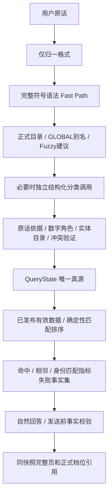

# AI 语义查询与正式候选链路（2026-10-12）

## 修改前审计

| 能力 | 当前结论 | 处理 |
| --- | --- | --- |
| thermal-lookup-mode、Parser | 指标、数字角色、容差已有集中实现；自然口语仍依赖长正则 | 保留兼容 Fast Path，引入独立语义分类 |
| QueryState、生命周期 | 已有 Zod SSOT 与增改删；新问题判断依赖主题词 | 统一语义 queryMode 后再合并状态 |
| intent routing | 有查表/计算/合规边界，规则预路由先行 | 保留安全边界，语义意图不得授权计算 |
| Entity Resolver、systemHint | 正式名称、GLOBAL alias、family/category 已有；Agent 入口未加载词典 | 所有正式查表入口接入同一目录 |
| schemeId/systemId/constructionCode | 行 ID 唯一；词典中重复 code 会直接歧义，未按体系收窄 | 关联体系上下文，无法唯一则澄清 |
| Candidate Matcher/Ranker | 已用统一容差与距离排序，正式硬条件验证可复用 | 分离命中、相邻、身份匹配指标失败 |
| reference page/fact validator | 同页同构造四项绑定、权限重验、语义事实校验已具备 | 保留，不重做原页/渲染/公式 |
| confirm/thermal rows | 仅传 thermalSetId 才写 DRAFT 行，有警告但无明确状态 | metadata 状态 + readiness 可观测，禁止自动发布 |
| pageLabel | PNG/ZIP 文件名和手动空页序被标 MANUAL/verified；confirm 无页码也 verified | 来源与确认状态分离，阅读禁用未确认页码 |

根因是语言理解、Tool 参数和历史继承分别决策，未形成同一个受验证的语义结果；页面确认与正式热工发布属于两个独立工作流，却缺少清晰的同步诊断。

兼容风险：API 裸 K 仍默认上限，AI 默认近似；历史会话 JSON 与确认原页 ID 不变；知识页确认不能自动创建或发布正式体系/规格/参考集；未确认印刷页码需隐藏。无需新增数据库字段，可使用现有 GLOBAL 词典和页面 metadata。

## 验证用失败案例（修改前登记）

使用请求中真实业务失败表达：薄抹灰 K≈0.3/20厚、板自身 R 做到8.3、新问题错误继承 R、重复 A1-3、A1-3/18mm/0.303 对 EXACT 0.300、page-001 误当印刷1。自动回归先固定这些案例；HTTP/SSE UAT 结果独立记录，环境失败只能标 BLOCKED。

## 1. Current Audit

修改前能力分类见上表。QueryState、容差/指标匹配、排序、发布守卫和完整页模型继续复用；语言理解入口、候选身份失败解释、页码信任标记需要修复。对照 HEAD 快照的受影响测试，记录到19项既有失败（10个测试文件、125项测试中106项通过）。后续不能把这些失败误认为新增回归。

## 2. Root Cause

Agent Tool 与非 Agent 入口各自理解语言，Tool没有接入正式实体词典；长正则决定口语含义，历史参数在主模型/规则两处继承。另有两套 optionId：候选绑定走旧页面渲染器，完整页走确认快照渲染器，导致真实候选和返回高亮不一致。页图上传把文件名/页序当成已核验印刷标签；资料确认与选用表发布是两条工作流，缺少同步状态。

## 3. New Semantic Query Architecture

不改热工公式、PDF识别、向量基础设施或人工来源选择机制。Agent `thermal`、已选来源的知识回退和普通查表入口复用解析服务；B端同版本知识测试继续使用既有确定性快照Parser/Matcher。

## 4. Rule Fast Path

`normalizeSemanticText`只处理NFKC、标点、空白及单位表示。完整 `K<=0.3`、`R0>=3.3` 和多指标符号表达直接输出结构化约束；指标正则与厚度解析保留为兼容规则。自然口语走分类模型，不为每个句子增加特判。原话明确符号优先于模型分类；普通 `<`/`>`仍按包含边界。数字角色只检查相邻单位，避免后面的mm污染构造编号。

## 5. LLM Semantic Parser

`parseSemanticQuery`输出固定Zod Schema：queryMode、intent、constraints、preferences、unresolved、confidence。模型没有Tools，不读业务事实，不生成正式ID。每项条件必须提供连续原话evidence，目标值必须来自该片段；实体回查完整目录。页号/构造编号/年份/数量不得成为指标目标。已明确条件不得被模型漏掉，OR不得变为单条件。

模型通过现有DB场景Runtime解析，优先可选内部`semantic_query`配置，未配置时使用当前会话场景的已准入模型；解析与回答是独立调用，可绑定不同模型。预算为内部SEMANTIC_QUERY策略：4096输出token、12秒、0次SDK重试，无工具。不新增模型ID/服务商硬编码。调用用量和决策写审计；取消信号传入分类调用。分类不可用时保留已支持的兼容解析并明确记录LEGACY_FALLBACK，不能宣称已通过真实开放语言验收。

## 6. Entity Resolver

Level 1复用正式名称、GLOBAL启用别名、由正式系统名称派生的family与systemType category。Level 2字符串bigram相似度只产生目录建议，不自动确定正式ID。Level 3分类模型从建议目录映射自然描述，再用完整目录验证。体系、方案、产品、规格、基层材料、地区、标准和建筑类型沿用QueryState现有字段；独立层材料等没有候选事实字段的约束不得编造映射。

新增体系/别名通过正式数据与现有知识词典维护。无需新增family/alias表或数据库列。族集合仍是硬约束，不能让其他体系的更近数值抢占；重复构造code按当前systemId/systemIds先收窄，仍多义则澄清。

## 7. QueryState Lifecycle

NEW_QUERY从空状态构建，CONTINUE_QUERY继承后增量修改，REFINE_QUERY按指标或厚度边界修改，COMPARE_SELECTED只比较冻结的明确选择。filters保持权威AND，兼容摘要继续派生。同指标默认替换，明确APPEND才增加范围；删除条件不能由旧摘要复活。厚度精确档/上下限分开，修改单边保留另一边，取消全部厚度清除厚薄偏好；同指标同模式可继承用户已授权容差。queryMode、semanticConfidence和parserSource作为可选JSON字段持久化，旧会话仍可读取。

## 8. Candidate Identity

正式候选以thermal_reference_rows.id为唯一身份，构造code只筛选。没有行ID的测试/辅助对象使用体系、方案、规格、构造、原页、厚度联合身份。查表来源页必须属于当前已发布、有效、可访问的知识版本；撤回/换版来源不再进入正式行查询。候选绑定的optionId与完整renderModel来自同一原始确认快照，不再使用另一套旧渲染器ID。

纯参数追问也会重新验证来源访问与确认档位绑定；失效来源或四项冲突记录从返回事实集中移除，不能仅隐藏签名URL后继续复述历史数值。

## 9. EXACT Miss Handling

结果分为matchedCandidates、nearbyCandidates、identityMatchedButMetricFailed。第三类必须通过所有身份、厚度和其他硬条件，只允许指标失败，附failedConstraints；不参与正式命中排序和选择。A1-3/18mm/K=0.303对EXACT 0.300可以回答实际0.303及未满足条件，不能切换到其他体系或70mm/90mm。Allowed Facts与发送前校验支持该独立事实集，禁止称为符合筛选条件。没有指标和历史指标时仍需确认指标，不按数字大小猜K/R。

## 10. thermal_reference_rows Consistency

确认时metadata记录NOT_APPLICABLE/NOT_SYNCED/PARTIAL/SYNCED及预计档位、写入/跳过数量、参考集与检查时间。识别详情和发布readiness重新检查当前行的构造身份、厚度、产品R、总R、K四项一致性，不只用计数宣称同步。

不传thermalSetId仍可确认资料并用于资料问答，明确显示“已确认，但尚未完整同步到正式方案查询”。已确认的DRAFT知识页可通过现有confirm-recognition接口显式补同步到DRAFT参考集；确认快照、热工行、chunk与审计同事务。知识发布与选用表审核发布独立；readiness给出未同步页计数与警告，STRICT沿用现有统一警告门禁。不会自动创建或发布体系、规格和热工参考集。

## 11. pageLabel Fix

PNG/ZIP文件名或物理页序推导为FALLBACK/false，显式上传标签为MANUAL/true；空手动标签不能verified。视觉识别使用数据库已有VISUAL_MATCH枚举（本轮VISION来源语义）/false，人工确认非空标签才MANUAL/true。AI、Wiki、完整来源模型隐藏未核验印刷标签；物理页序仍仅用于导航。展示投影不改变确认快照hash，印刷21与物理1始终分开。同步证据缺标签时用pageId，禁止用物理序号冒充。

## 12. Tests

新增原话依据、操作模式、口语/倒装、数字角色、族约束、Fuzzy建议、重复编号、NEW/CONTINUE/REFINE、厚度局部取消、EXACT身份失败、四项同步和页码信任回归；模型调用测试使用可控结构化结果，属于分类服务接线与验证器测试，不能替代真实模型UAT。

定向批次均通过：状态/生命周期/规格切换与Tool批次213项，事实与解析批次166项，来源页批次40项，页面确认/同步批次78项。各批次有重叠，不相加作为测试总量。

最终全量：166个测试文件，164通过、1失败、1跳过；1713项测试，1705通过、7失败、1跳过。失败全部为修改前已有的`thermal-constraint-flow.test.ts`正式CALCULATE继承/适用范围案例；仍不能宣称测试全绿。完整日志：`semantic-test-results.log`，基线对照：`logs/semantic-baseline-20261012/baseline-tests.log`。

| 检查 | 结果 |
| --- | --- |
| pnpm lint | 通过 |
| pnpm build | 通过 |
| pnpm db:check | 通过 |
| git diff --check（后端） | 通过 |
| pnpm uat:check | 通过，45场景/138轮；只验证类型与结构 |
| pnpm test | 1705通过/7既有失败/1跳过 |
| pnpm db:verify | 静态链通过，Docker不可用，动态迁移验证BLOCKED |
| 真实HTTP/SSE UAT | 配置库ECONNREFUSED，0轮执行，3轮BLOCKED |

真实UAT场景目录扩展为45场景/138轮。已运行SEMANTIC-001的隔离HTTP/SSE验收，配置数据库ECONNREFUSED：计划3轮、执行0轮、BLOCKED 3轮，不算通过。报告：`logs/ai-uat/semantic-2026-10-12/report.md`。迁移静态检查可运行；容器迁移验证因本机无Docker无法启动。

## 13. Modified Files

- 新增：thermal/semantic-query.ts、thermal-entity-suggestions.ts、thermal-candidate-identity.ts及语义回归；ai/semantic-query.service.ts及调用测试；knowledge/knowledge-thermal-sync.ts及回归；shared/page-label.ts、readable-page-render.ts；UAT语义场景与本说明。
- AI：ai-agent.service、ai-generation.service、reference-query.service、ai-reference-pages.service、thermal-answer-facts/validation、thermal-calculate/search-knowledge Tools、reference-page兼容类型。
- Thermal：query-state/dictionary/entity-resolver/debug、candidate.service/schemas及候选服务测试；内部任务runtime policy。
- Knowledge：页图upload/gallery、recognition、readiness、Wiki/test-reference与确认接口描述；对应原页引用回归改为当前optionId/fieldKeys/full model契约。
- 规则：AGENTS.md、README.md、Cursor AI规则、技能AI/文件参考；UAT场景索引与数量契约。

## 14. Migration / Breaking Changes

无DB schema/SQL迁移，无公式变化；既有URL和字段保留，新结果/状态为可选附加字段。旧API裸K默认上限，AI默认近似，容差仍由同一模块限制。视觉页码沿用既有VISUAL_MATCH，避免新增枚举迁移。确认接口无thermalSetId时重复确认仍拒绝，只显式带参考集时允许确认页补同步。需要前端主动展示新增同步状态；本轮未改B/C端代码。

## 15. Remaining Risks

真实模型语义准确率、额外分类时延与费用、数据库内存量错误页码/未同步档位尚未进行在线验收。历史被误标MANUAL的标签无法可靠区分文件推导与真实人工输入，需管理员核对，不自动重写生产资料。语义分类不可用时仍有兼容旧规则，开放口语覆盖需在可用隔离环境中实测。独立层材料没有正式查询维度时须澄清，不能假装已支持。

修改前已失败的7项正式CALCULATE继承/适用范围测试仍与“Tool Schema要求显式方案/规格/厚度”的当前实现冲突；本轮未重做正式计算入口或公式。交付不得宣称pnpm test全绿或业务UAT通过。

执行环境记录：基线快照的依赖链接在跨盘移动时被展开，触发本地依赖恢复；已用冻结lockfile离线恢复并重新完成类型检查、构建和测试，未改依赖清单或锁文件。临时链接删除动作被自动审批拒绝（工具仅返回`blocked by policy`）；快照代码已移到本机Codex临时目录，仓库内残留链接被独立临时gitignore隔离，不属于交付改动。
